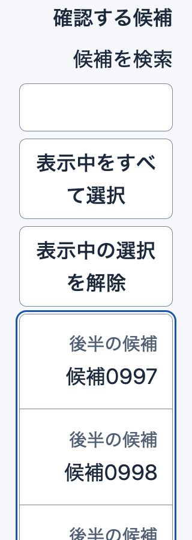
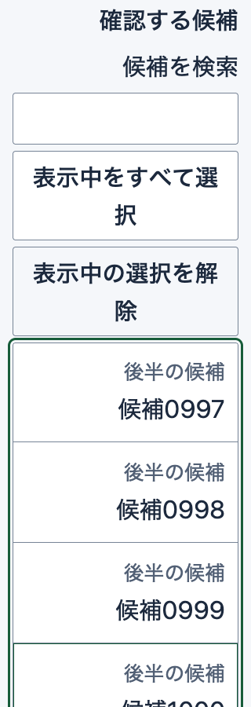
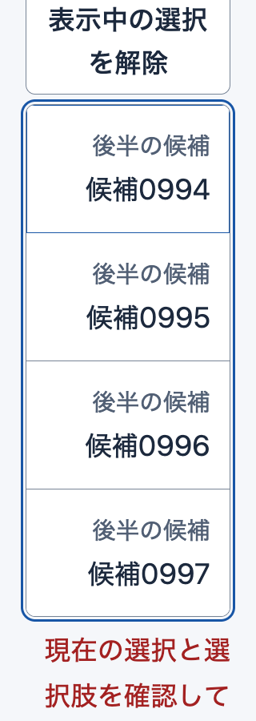
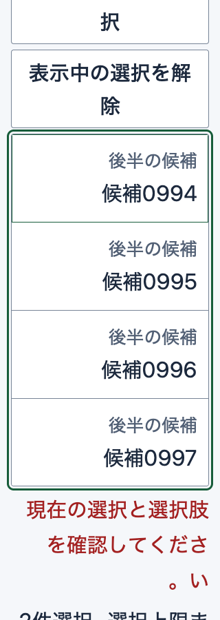
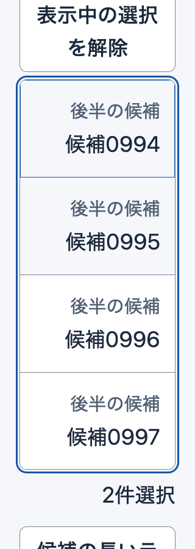
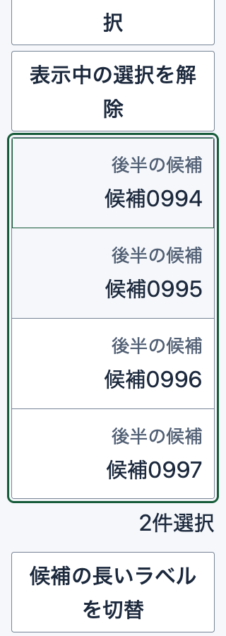
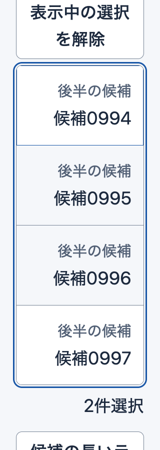
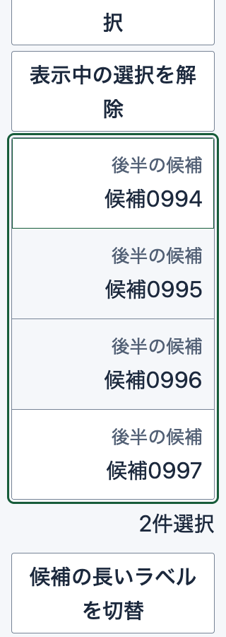
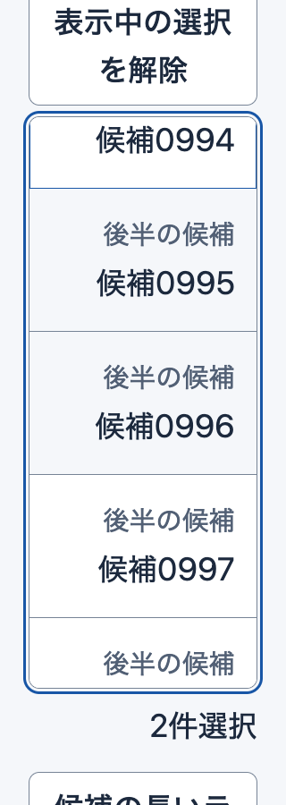
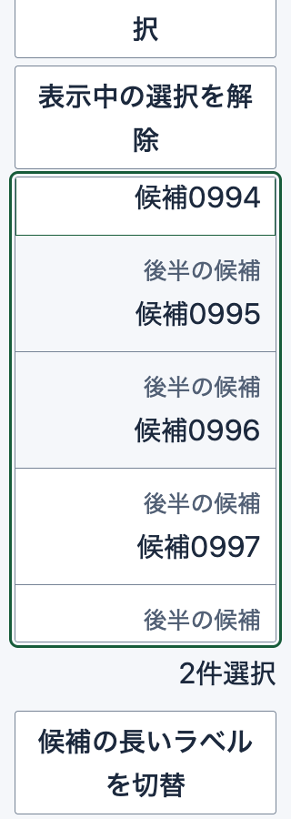

# PR10 color-contrast 未確定24件の独立調査

**元24件は、仮想Listboxのviewport外bufferに対する自動判定不能だった。今回観測した通常・選択・focus・不正値保持の状態で、実際のcontrast不足は確認しなかった。template修正は不要と判断する。** 原axeの`incomplete`はそのまま保持し、この追調査を別の根拠として追加する。

対象mainは`8d01adc6497addd97428507a0d3239dbe093a6a9`（PR10merge）。専用/tmpへ420trackedfilesをblob照合し、正本からsync/check、strictngc、公開Angularlinker、Tailwindを実行した。全5コマンドは実終了0、420正本ファイルは生成後も一致した。共有source/Git/GitHubへの書込みはない。

## 対象と既存・新規の判定

元`docs/verification/ui-library-collections-2026-10-06.json`のdrawing.axe index1/2/8/9、guided/denseの`narrow-listbox`と`invalid-preserved-cva`を再現した。各状態のoption0994/0995/0996のgroupspanとlabelspanの6領域、計24occurrenceは、**同じselectorで24/24再現**した。部品は`templates/angular/listbox.ts:26–34`の公開CDKviewportとdefaultrow。元理由は背景が別要素で部分的に覆われ、backgroundを決められないというものだった。

このListbox実装・仮想viewportのclip条件はPR10の`62fbe85`で追加され、PR9base`04dc3f4`に同templateは存在しない。一方、ink/muted/white/canvasおよびprofileの色対応はbaseから不変で、YAML差分は一覧の寸法8行のみだった。したがって**描画条件に伴う自動未確定は新規、色トークンは既存、色変更による実回帰は未観測**と分ける。他段階の部品や旧評価をここで判定し直していない。

## 実測と描画

Chromium153.0.8010.12、axe4.13.0、320×900px、rootfont200%、RTL、reducedmotionで、nativeEndにより候補1000をactiveにした。guidedのviewportclientheight638px/row160px、dense510px/row128pxで、DOMには終端近くのbufferも残る。

**元24のspanは全てviewportclip外で、paintedarea0・可視割合0だった。clip後の空領域に対するforeground countも0だが、このcountだけを独立したraster証明とは扱わず、clip geometry・hit-test・実画像を併せて判定した。** DOM上のbboxが検索label/inputや選択buttonと同じpage座標にあるため、hit-testはその別nativecontrolを返した。実際にはviewportのoverflowclipで文字を描いていない。原caseは部分的に見える文字の低contrastと同じものではない。不正値復元後はボタンへのnativepage移動も発生するが、同じbuffer判定を保った。

nativeArrowUpで0994へ移動し、viewportをpage内へscrollして0994/0995/0996の全文を表示した。`['gone','gone']`はSpace後も保持され、明示resetの後にnativeSpace/Arrowで0994/0995、次に0995/0996を選択した。全36可視測定で、opaqueforeground、transparentbackgroundの祖先合成、painted領域hit-test、元PNGの実foregroundcorepixel/背景sampleが一致し、対象36nodeはaxeのcolor-contrast`passes`にも入った。

| 文字/状態 | foregroundRGB | 背景RGB | contrast比 |
| --- | --- | --- | ---: |
| group通常・不正値保持 |82,96,117|255,255,255|6.385333 |
| group選択 |82,96,117|245,247,250|5.949679 |
| label通常・不正値保持 |28,41,61|255,255,255|14.645016 |
| label選択 |28,41,61|245,247,250|13.645826 |

全て4.5:1以上。基準は[W3C SC1.4.3](https://www.w3.org/WAI/WCAG22/Understanding/contrast-minimum.html)と[relative luminance](https://www.w3.org/TR/WCAG22/#dfn-relative-luminance)のsRGB計算を使い、Nodeと独立Pythonで同値を確認した。通常配信時は14/16/18pxのregulartextなので、200%表示を理由に判定閾値を3へ下げていない。AAedgepixelの最小比をcontrastと扱わず、指定色と実際のopaque背景の組を評価した。aria-hiddenのgroupも可視文字として測った。

さらにnativewheel半行で部分rowclipを別に再現した。0994groupはclip外、labelのlineboxはguided0.9357/dense0.9277だけ可視だが、そのwheel量ではglyph自体は全て残りforegroundcore数も同じだった。0995/0996は全可視。これを元24の全clipと混同していない。

12原PNGを全てtools.view_image(original)で実viewした。可視group/label、選択背景、active枠/compositefocus、赤い不正値説明は測定と整合した。ChromeAXではprimarylistbox1、各optionの完全labelとgroup親「後半の候補」、selectedとCVAmodelの一致を確認した。これは実screenreader/physicalAT試験ではない。

## 自動結果を保った結論

今回の12rawaxe状態はviolations0だが、color-contrastincompleteは**90occurrence**残った。元4状態24に加え、全可視へ移した6状態では別buffer0990–0993が48、半行wheel2状態では同bufferと0994groupが18である。元対象が可視時にpassesへ移ることと、全体未確定をゼロにすることは別である。rawのcontrastRatio0は判定不能metadataであり、実測0:1ではない。ruleの除外・disable・原結果の成功への書替えはしていない。

元24件に色/透過/clipの修正は不要。viewportbufferを無理に非表示化してAX所有やキーボード契約を変える根拠もない。今後token/CDK/rowlayoutを変更する際は、この同条件で元selectorを再現し、全可視の通常/選択/不正値保持、alpha祖先、nativeAX/model/focusを再測定する。

Safari/Firefox、SSR、shadowDOM/別document、physicalAT/OS-touch、任意のappCSS/customprofile/forcedcolors、人の業務理解は未実測。これらやWCAG全体の認証をこの結果へ追加していない。

| 実コマンド/確認 | 実結果 |
| --- | --- |
| 固定main gitarchiveと420blob照合 |終了0 |
| `node --import tsx src/cli.ts sync` / `check` |各終了0 |
| `ngc -p tsconfig.json` / `node scripts/build.mjs` / TailwindCLI |各終了0 |
| `python3 run-browser.py` |終了0、2profile×6状態、nativekeys/wheel、12axe、12PNG |
| `python3 verify-evidence.py` |終了0、21/21チェック、独立contrast再計算 |
| 元PNGのmanualview |12/12実view |

browserは`2026-10-06T05:22:38.865463+00:00`–`2026-10-06T05:23:11.179413+00:00`に実行した。終了時に自前browser/server5335を閉じ、readonlylsofでlistenerなしを確認した。最初の終了port確認はsandboxのsocket接続EPERMで終了1となったため、そのharness失敗を保存しreadonlylsofへ変更した。製品結果・axeは変更していない。

根拠は[24対応表](original-24-occurrences.json)、[機械報告](collections-contrast-audit-2026-10-06.json)、[rawnative結果](contrast-browser-results.json)、[21検査](verification-checks.json)、[履歴](source-and-token-history.json)、各rawaxe/PNG/commandlog/exitとcopymanifestに保持する。

| 状態 |guided |dense |
| --- | --- | --- |
| 元End1000 |||
| 不正値保持・全可視 |||
|0994/0995選択 |||
|0995/0996選択 |||
| 半行clip |||
