# 選択・値編集・入力手順7要求（2026-10-06）

[PR #9](https://github.com/ist-h-i/ui-foundation/pull/9)のbaseは `657e5ba3f2993bc85912f5801bb7a7d9966c2b7a`、コードと試験の固定HEADは `07d3d63cd6de2f35eb9c0ce23532147c0678d685`。描画・独立production runtimeの実装は `f7ecd1468d062b0e5e01059c0e28c9827517f376` で、固定HEADとの違いはconsumer試験の時間制限とabort signalだけである。専用branchで作業し、利用者のlocal mainや他の作業をresetしていない。

対象はforms-22..26/29/30。原文181行、制御項目、sourceLineを保持し、他174要求を変更しない。全依頼は未完了である。

## 実装と責任範囲

Slider/RangeSliderはnative range、範囲・刻み・目盛り、交差しない開始/終了、単位、required/CVA/Validatorを持つ。Knobは同じnative rangeへ円形表示を接続し、pointer captureと上下ボタン、読取り専用・busy・disable・破棄時の解除を持つ。受け入れた大きい整数領域でも刻みを失わない。

Ratingはnative radioで段階数・半段階・解除・読取り専用を扱い、RTLでも値と総数の数値順を保つ。ColorPickerはhex/rgb/hslと透明度、名前付きpalette、native colorと文字入力を接続する。不正な入力を勝手に有効な色へ置換せず、alpha=0を保持する。native colorはRGBの選択を行い、透明度は別入力で制御する。

InlineEditは同じeditorで編集・取消・保存失敗・再試行を行う。保存要求idとpreviousValueで古い応答を拒否する。外部valueが反映された場合は要求を失効させ、同じeditorへ新しいdraftを反映する。CVA resetは同じ値でも同期的に失効させる。親が値を更新してからAngularが子のinputへ反映する前に応答する場合、アプリは先にinvalidatePendingを呼ぶ。UIのpending解除は外部I/Oのabortや保存成功ではない。

Wizard/Stepperは現在段階、進行可否、戻る、分岐、保持された入力を持つ。隠れたpanelは破棄せず、入れ子のWizardは自分のStepだけを所有する。段階が除去された場合も自分が持っていたfocusだけを移し、無関係なfocusを奪わない。完了通知は手順の完了でありbackend保存の保証ではない。

FilterBuilder/QueryBuilderは型付きtext/number/boolean/date/choice条件、AND/ORと再帰group、実ローカル評価、保存・解除を持つ。不正な条件を残し、0/false/欠損を区別する。保存中に条件、field定義や検証結果が変われば古い成功・失敗を拒否し、新しい条件を誤って保存済みにしない。同じJS turnの親側定義更新では明示的なinvalidatePendingを用いる。アプリがI/O・永続保存・実Undo・安全継続判断を所有する。

size.knobをsemantic roles、YAML正本、生成CSS/Tailwind/contextへ接続した。primitive直接参照、旧互換API、新規依存、有償service、npm公開、OS設定変更はない。

## 独立レビューと修正

fresh reviewerがbase/head、入口文書・Skill・設定・生成・consumer・実描画を独立に確認した。初回はP1二件とP2三件を指摘し、修正後に以下を独立再検証した。

- F1/P1: 外部value更新後にInlineEditが古いdraftを公開した。外部値/CVA reset/明示失効を接続し、同じeditorの新draftと古い成功・失敗の拒否を確認した。
- F2/P1: fieldの型変更後にFilterBuilderが無効な条件を保存済みにした。定義と再検証も要求の失効条件へ含め、invalid draftを保持し保存済みsnapshotを更新しないことを確認した。
- F3/P2: 復元したfilterのnative選択とモデルが違った。動的option自身のselectedを接続し、金額/gte、false、欠損日付の実表示を確認した。
- F4/P2: RTLで評価比率が逆順に見えた。数値部分をbdiで分離し、実描画の3.5/5を確認した。
- F5/P2: toPrecision(15)が受け入れた大きい整数の最初の刻みを消した。安全整数と刻みに比べた誤差で丸めを制限し、native ArrowRightとモデルの1000000000000001、次の刻みとEndを確認した。

Paletteのaria-labelを持つ領域にもrole=groupを接続した。source/fullは固定HEADでapprove、未解決の観測P1/P2なし。最終証拠commitはsource不変のdeltaを独立照合してからマージする。

独立choice検査は86件（操作78/axe8）・実終了0。別snapshotのstrict AOT/production consumerと6件のnegative AOTは224708.860125msで実終了0。model75/config67/ui:check/typecheckも実終了0。manifest74 SHA、compiled runtime63 SHAと、両profileで実受信したbundle SHAを照合した。P1 edge consumer、large-number edgeと8描画状態も実終了0である。これらをrootの全試験件数へ足し合わせない。

## 検証

固定HEADの全npm testは **791件・実終了0**。設定67、生成15、モデル75、UI634（14.4m）。開始 `2026-10-06T00:16:10.664106+00:00`、終了 `2026-10-06T00:31:53.364067+00:00`、終了時HEADも同一である。ui:check、strictTemplates/AOT/typecheck、別生成production consumerを同じrunで実施した。予定数や途中成功の合算ではない。

最初の2952 runは独立指摘修正のため実終了130で中断。f7 runは生成consumerの120秒制限で1件cancelled、実終了1。制限を240秒へ変更し、各子処理へtest signalを渡した。07の第三runはexecutor接続切断でUI308までのログと終了コードなしを記録し、合格へ数えない。残った今回のserverだけをcommand/cwd照合で終了した。第四runは独立したsessionで終了記録を保持して全体完走した。

修正前のlarge-number純関数と外部InlineEdit応答は失敗ログを保持し、修正後のmodel75/重点28もそれぞれ実終了0。全試験とは別の回帰根拠である。コードと試験を固定したまま16画像と本記録、matrixだけを最終更新する。

自動アクセシビリティはrootの8状態で違反0、color-contrastの未確定89 node occurrence。内訳はaria-hiddenの★80、Knobの「−」8、guided狭幅filter-modelの部分被覆1。独立描画の8状態は違反0/未確定88で、別の観測として保持する。PaletteのARIA未確定は修正後にない。未確定を合格やWCAG認証へ置換しない。

補助ログは/tmp/ui-foundation-choice-full-fourth.head/.log/.exit/.json、choice-review/report.md/review-summary.json、choice-drawing-fixed.json。再現できるrepoの証拠はtests/ui/choice-catalog.spec.ts、tests/model/choice-model.test.ts/filter-model.test.ts、tests/generation/consumer.test.ts、scripts/consumer-browser.mjsと[機械記録](ui-library-choices-2026-10-06.json)にある。

## 描画

修正後のruntimeで16枚を2026-10-05 23:57:16.493–23:57:39.253 UTCに取得し、全16枚をrootが実viewした。Chromium153、guided/dense、1280pxと320px/200%/RTL/reduced motion、ページ全体overflowなし、pageErrors=[]。日時は全体検査終了日と撮影日を区別する。資産・画像SHAと実view根拠は機械記録に保持する。

| 内容 | guided | dense |
| --- | --- | --- |
| 数値・範囲 | 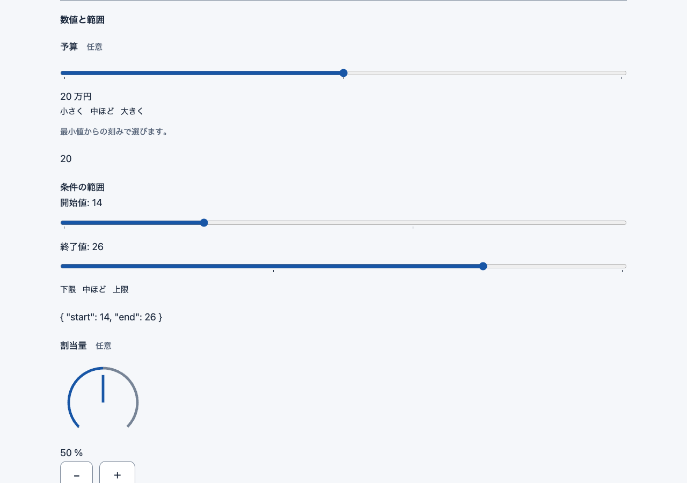 | 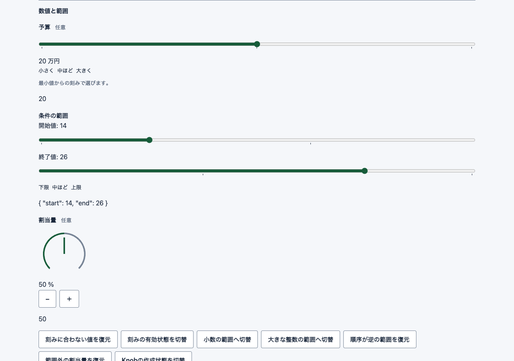 |
| 無効な色の保持 | 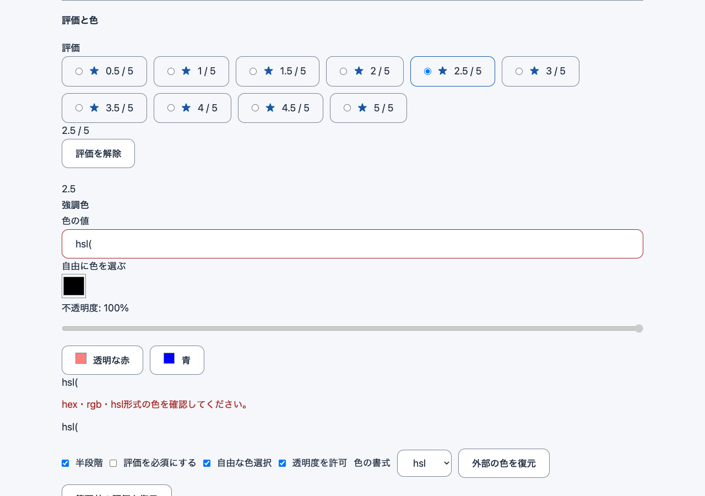 | 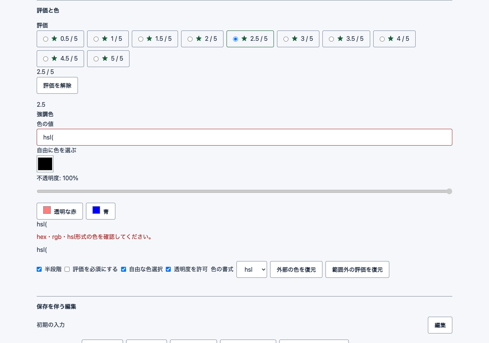 |
| 保存失敗の編集値 | 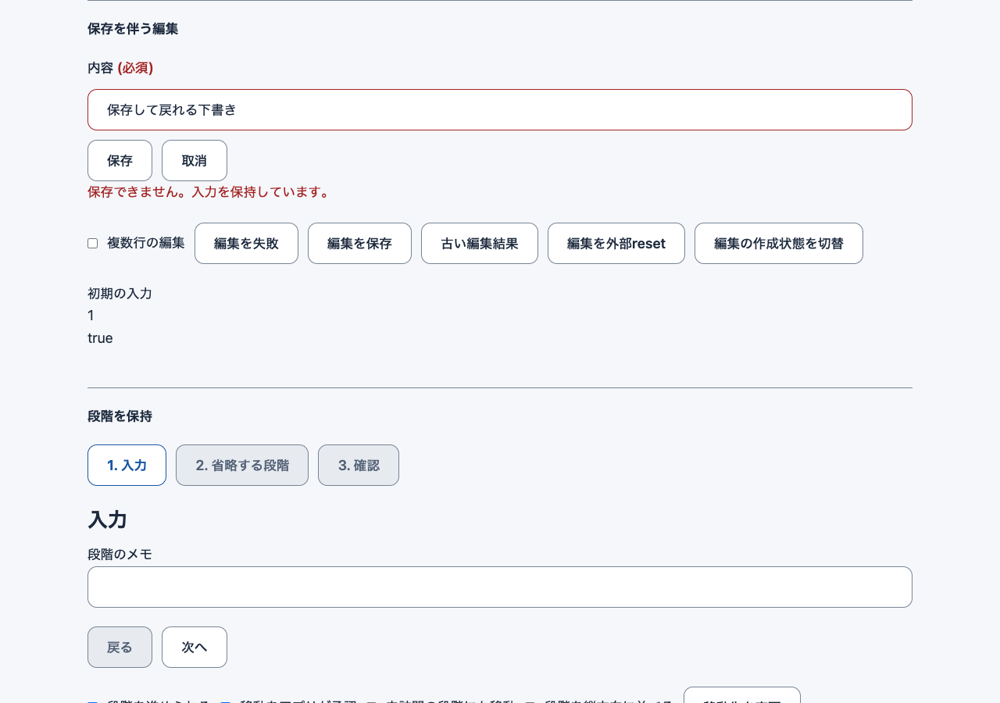 | 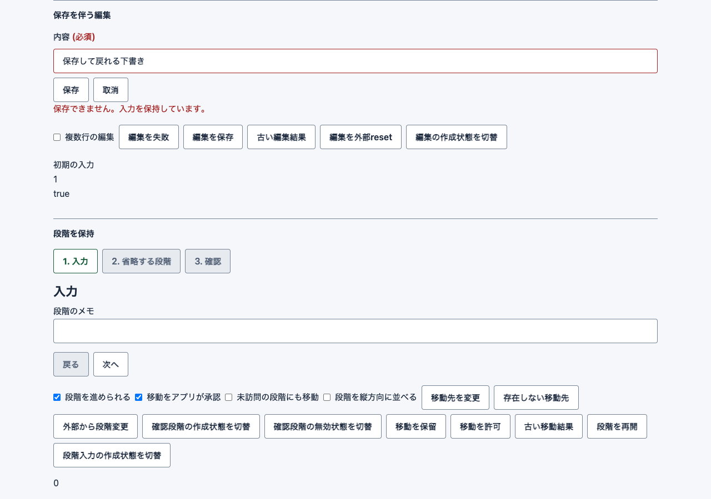 |
| 分岐後の確認 | 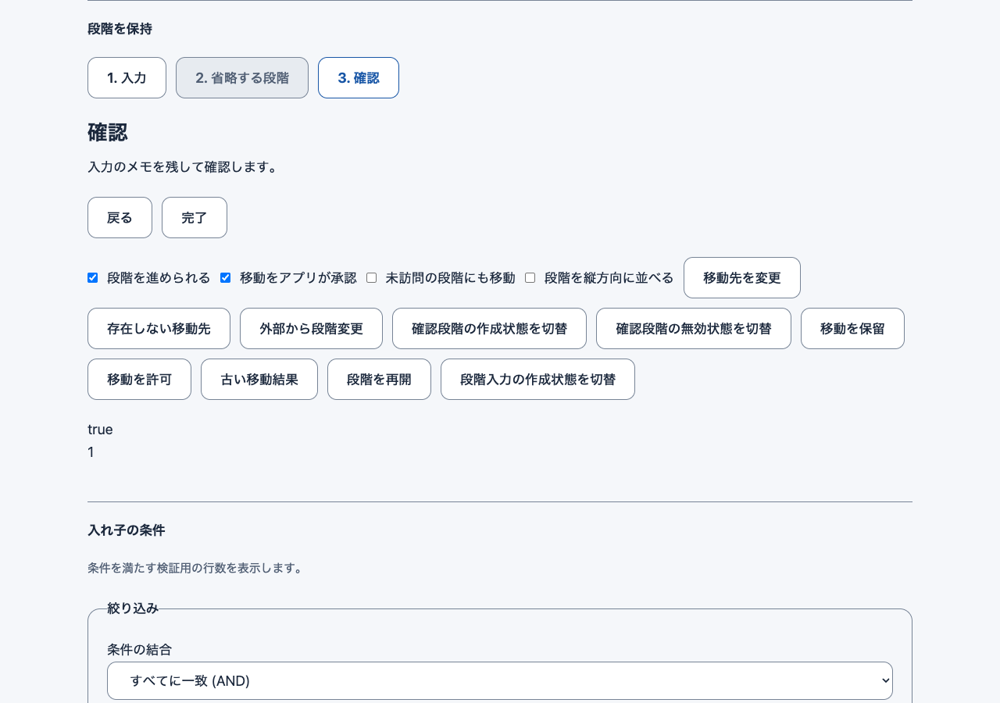 | 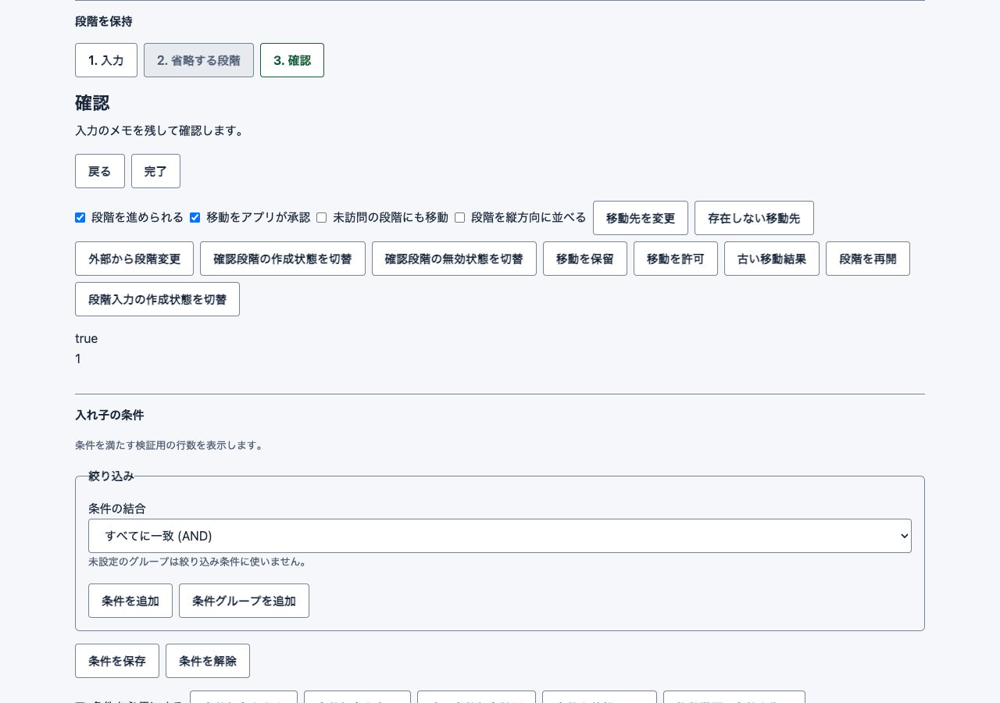 |
| 復元した入れ子条件 | 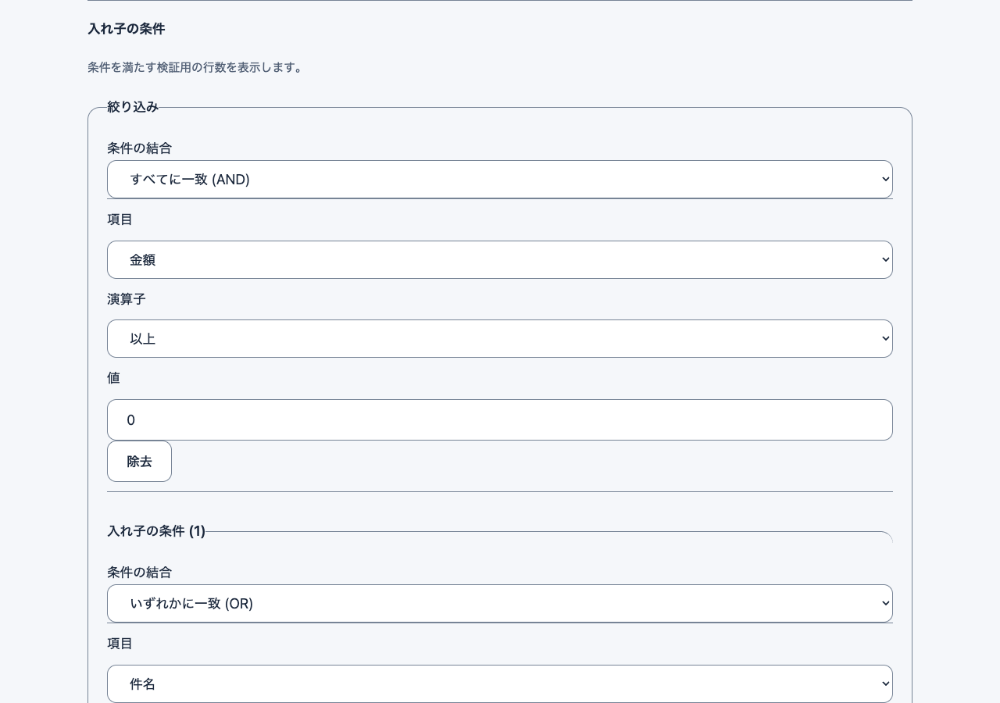 | 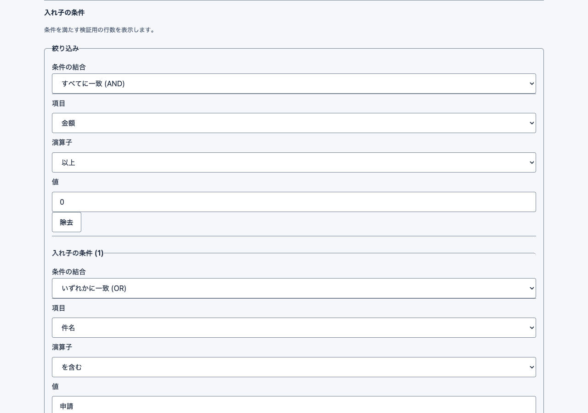 |
| 評価の数値順 | 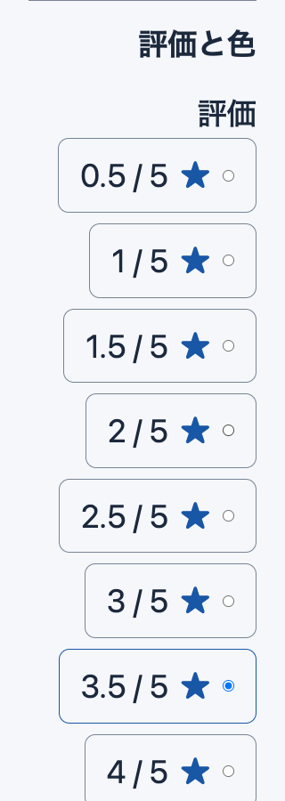 | 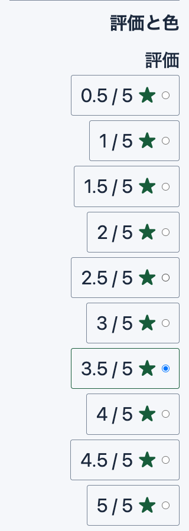 |
| 透明度・色入力 | 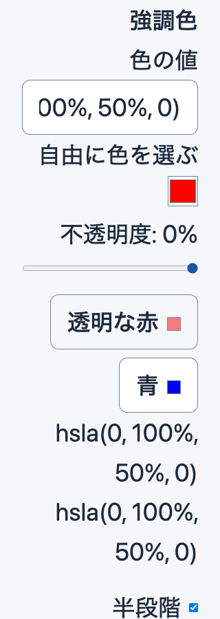 | 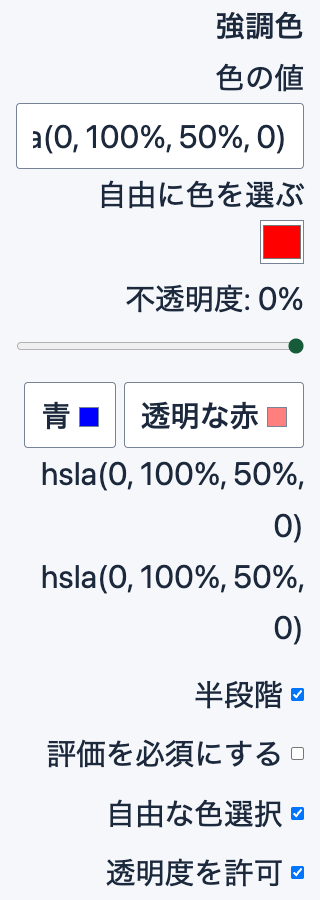 |
| 条件の狭幅入力 | 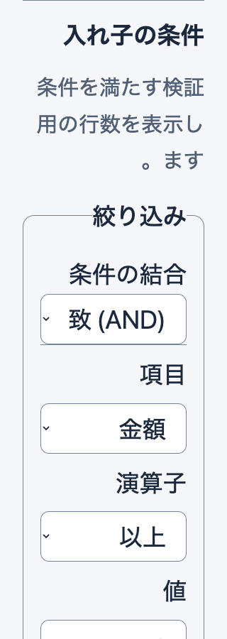 | 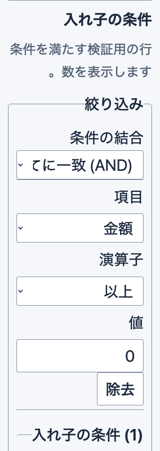 |

guidedの数値全体はviewportより長く、一枚で全ボタンを見せる保証ではない。各操作へのscroll到達は実操作試験で確認した。狭幅のnative input/select内の長い文字は局所表示となり、入力・選択値を切捨てていない。RTLの数値順、復元したnative選択、透明度0と失敗時の同じeditor保持を実描画で確認した。

## 残件と限界

対象7行だけを更新した結果、**181要求中121 verified /11 partial /49 pending**。残る60要求は入力・階層、予定、一覧・表、媒体、専門部品と共通基盤を継続する。次の一覧・選択・仮想scroll試作はこの完了件数に含めない。既知のoutput移行時Skill所有情報P2は固定出力の同期を妨げない残件として保持する。

実screen reader、Firefox/Safari、OS-native color chooser、touch支援技術、実backend保存/abort/Undo、全ソースAST逸脱検査、人の業務評価は未実施。GitHubのworkflowとreview threadは今回読取時0で、CIを唯一の完了条件にしていない。Mac appへのPR添付はTransport closedで成功未確認、GitHub PR/Issueの成功と区別する。
