# 一覧・移動12要求（2026-10-06）

[PR #10](https://github.com/ist-h-i/ui-foundation/pull/10)。base `04dc3f4bc71161a5fff0860d810e73272a729499`、source・描画・独立consumer `85c5ffdea19135010a30f2cbcf327f77d4ca5669`、全試験固定HEAD `d81d6177166f419d5656440d217cb7d9849b7a22`。差分は新しいデモボタンを含むTab順の期待値だけで、実装・設定・fixture・Skill・生成物は同一である。原文181行と全制御項目を保持し、今回の12行のみ完了へ更新する。全依頼は未完了である。

## 実装と契約

List/ListItemは行内容・補助情報・意味アイコン・操作slot・区切り、MasonryはCSS columns・列数・gap・幅別配置を持つ。DataViewは実ローカル検索・自然順ソート・ページ送りとlist/grid切替を行い、同じ安定キーのeditorを保持する。無効な機能の保存条件を勝手に適用しない。

Listbox/SelectionListは単一・複数選択、検索、group、全選択・選択不可、CVA/required/max validation、実AXのoption/group所有関係を持つ。不明キー・重複・無効な復元値を残して復旧を示す。仮想・通常表示ともnative Tabで一つのcompositeから外へ進める。VirtualListは公開CDK固定高さstrategy、意味トークンによる行とviewport、先読み、論理scroll位置、1000行の終端とbounded DOMを持つ。公開viewport clientWidthを所有行へ適用し、長いdefault labelは実ellipsis、projected内容は行内scrollとなる。appが安定キーで編集状態を保持する。

Sortable/OrderListとTransfer/PickListは公開CDK drag/handle/Dir、pointer・touchとnative移動ボタン・取消可能なkeyboard draftを接続する。原snapshot・安定キー・permissionのtrue-only判断、source/dir/filter/値の変化で古い移動を拒否する。公開CdkDrag.resetで取消後の実座標を戻す。入れ子EscapeはOverlay operationで子を取り消して親へ戻る。Transferは検索・複数のchecked範囲・一括移動・順序変更とtyped CVAを持ち、hidden/disabled選択や上限を原子的に扱う。

InfiniteScrollはnative IntersectionObserverと明示取得・終端・失敗・再試行を持ち、idle invalidateでもobserverを再登録する。旧observer callback/応答、reset・破棄・再作成を拒否する。Timeline/ActivityLogはoffset付き日時、日時不明と種別不明の区別、native details、typed slot、同じ詳細editor、追加取得と失敗表示を持つ。request idは同じbundle内の識別であり、backend完了/通信abortを保証しない。appが実I/O・保存・business permission・Undoを所有する。

CDK22.2.1はMITの正規依存で、意味roles size.collection-item/viewportを正本YAML・schema・生成CSS/Tailwind/contextへ接続した。[ADR0002](../adr/0002-collections-cdk.md)に公開APIの選定と再検討条件を残す。Materialの外観、private API、旧互換API、有償service、npm公開、OS設定変更はない。

## 実検証と独立レビュー

全 `npm test` は **880件・実終了0**（設定68、生成15、モデル93、UI704）。開始 `2026-10-06T03:15:38.866370+00:00`、終了 `2026-10-06T03:42:48.488446+00:00`、前後HEAD同一。ui:check、strict AOT/typecheck、生成後production consumerと6 typed negative AOTも同じrunで実施した。予定数や部分試験の合算ではない。

旧62 runは浮動操作ボタンを閉じないconsumerで終了1、a188はidle IOの独立P2修正のため終了130、001は長いdefault labelの独立P2修正のため終了130。85 runは設定/生成/モデル176とUI702が成功し、旧デモ順期待2件で終了1（878成功）。native Tabは長ラベル切替→選択方式へ正しく移動し、期待値を修正して全体を再実行した。確認harnessのsandbox listen拒否と不適切selectorによる失敗も/tmpに保持し、成功へ置換しない。

fresh reviewerは公開viewport幅とidle IOの元の再現を修正後に再実行し、exact source85をapproveした。独立config/model161、native操作32、IO/stale2、最小Virtual4・Listbox4、生成AOT/5型負試験、公開linker20modules、実consumer2操作、12画像実viewがそれぞれ実終了0。これらを880件へ足さない。旧独立consumer240秒timeoutは失敗のまま保持し、より小さいfresh公開consumerの成功と区別する。[独立報告](ui-library-collections-review-2026-10-06.md)。最終の証拠のみcommitはsource一致・12行・画像・実全体終了を独立照合してからmergeする。

[最小consumer比較](ui-library-collections-consumer-2026-10-06.md)は別snapshotで14コマンドの実終了0。baseline JS324236B/gzip104413B、追加581408B/gzip167208B、差257172B/gzip62795B。CSSは同一。adapter・Forms・CDK・共通コードの差分でありCDK単体ではない。barrel経由の未使用依存保持を別記録し、自動除去を保証しない。

## 描画・アクセシビリティ

runtime85で02:44:30.508–02:45:45.687 UTCに16枚を取得し、rootが全16枚を実viewした。Chromium153.0.8010.12、guided/dense、1280pxと320px/200%/RTL/reduced motion、page overflowなし、pageErrorsなし。14 axe状態は違反0、color-contrast未確定24 node occurrence（仮想Listboxの部分被覆）を保持し、WCAG認証へ置換しない。実native Space、same-editor/value/focus、long-label幅、1000番目・AX active/group所有、取消後の座標、Transferの実値、Timeline失敗時memoを確認した。

| 内容 | guided | dense |
| --- | --- | --- |
| 検索・行内容 | 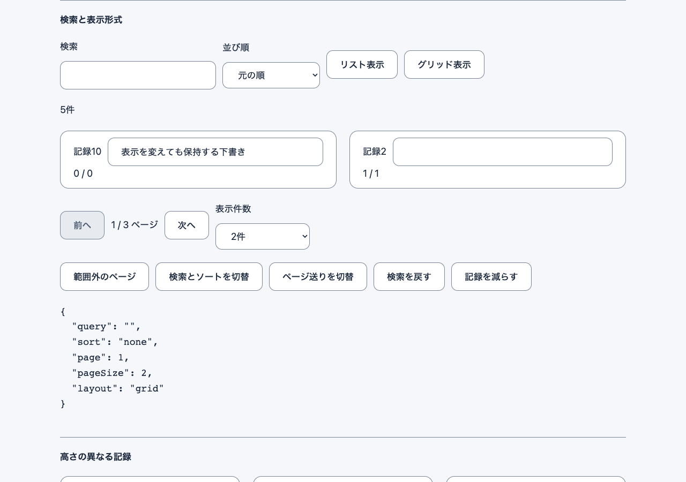 | 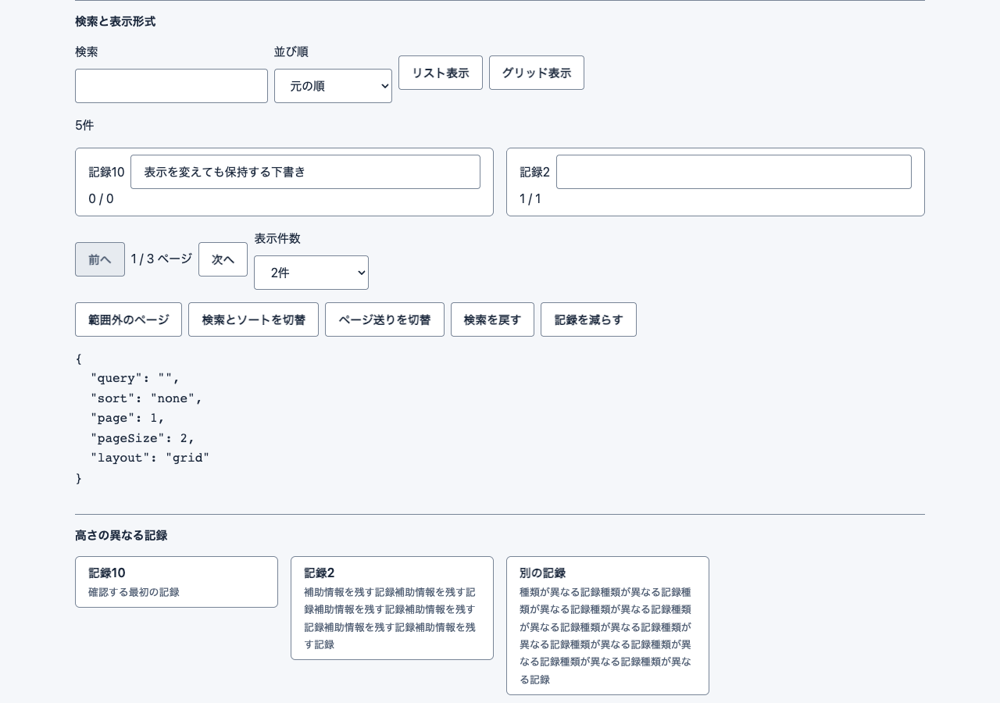 |
| 仮想Listbox終端 | 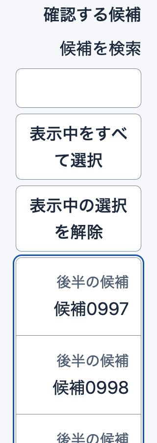 | 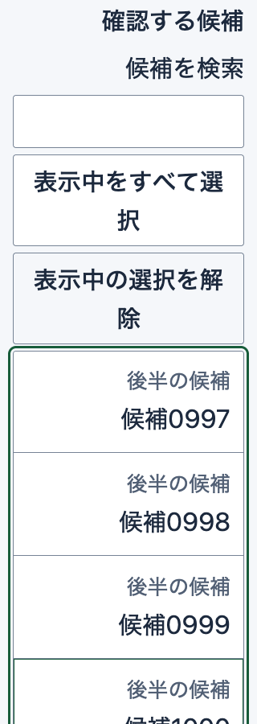 |
| 長い候補の省略 | 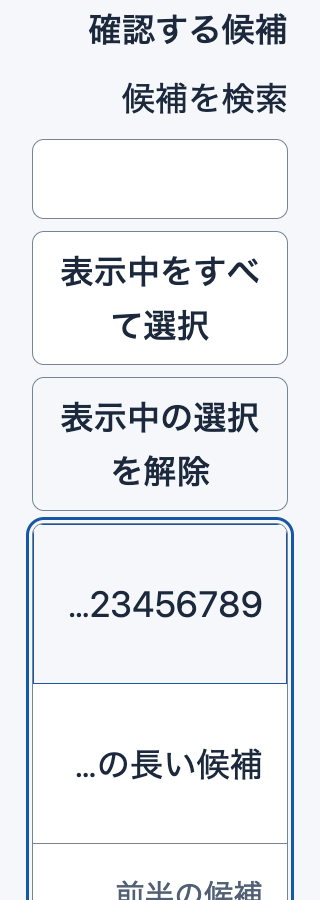 | 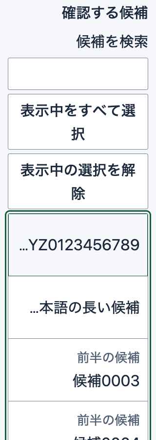 |
| 移動取消後の配置 | 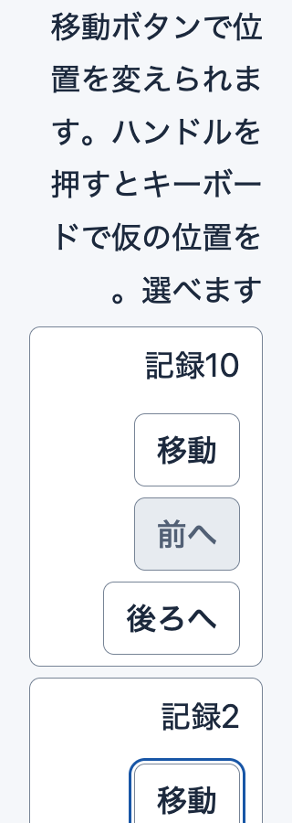 | 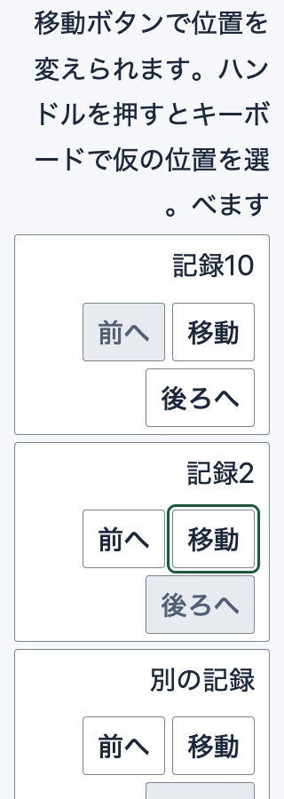 |
| 1000行目のeditor | 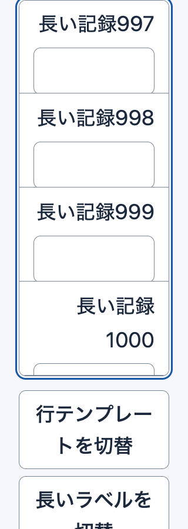 | 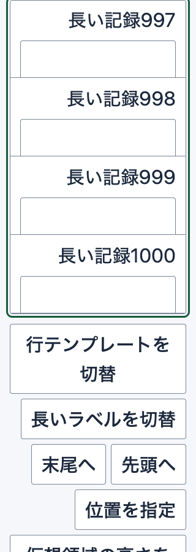 |
| 長いdefault label | 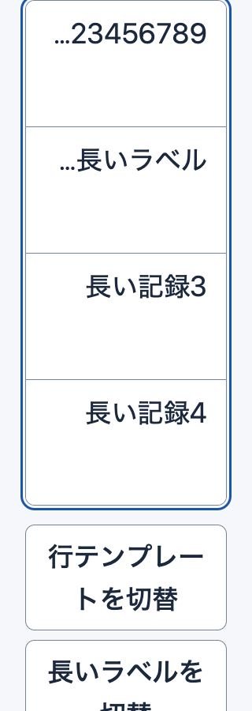 | 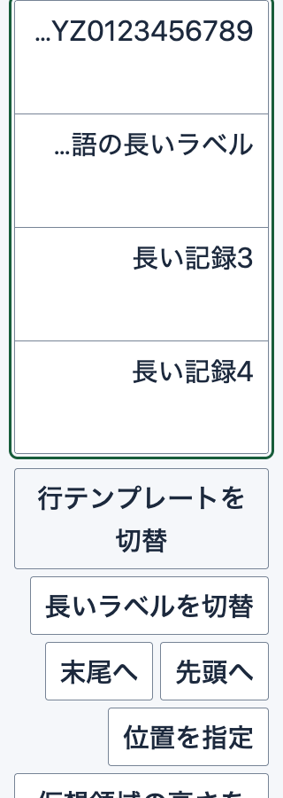 |
| 選択済みの移動先 | 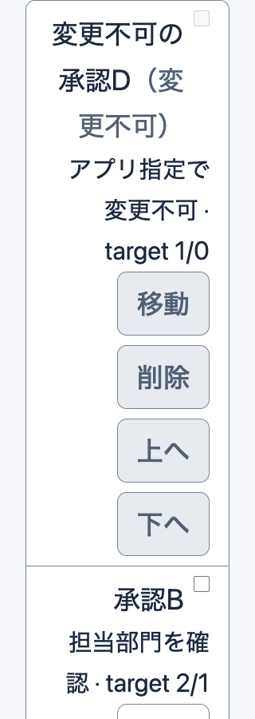 | 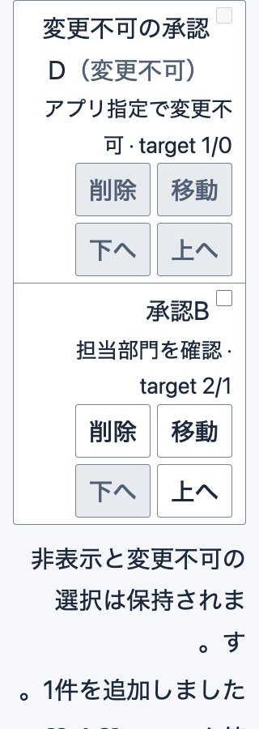 |
| 追加取得失敗 | 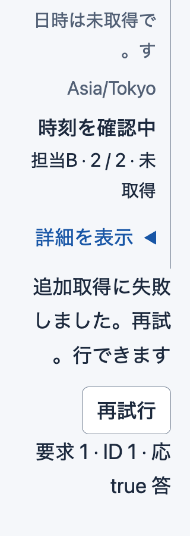 | 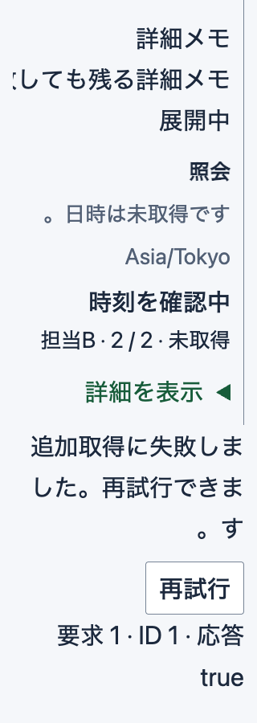 |

guidedのprojected編集行は固定高さ内の局所scrollを持つ。複数行の任意内容を可変高さへ自動変換する契約ではない。長いnative inputの値は局所表示し、保存値を切り捨てない。既存dummy/stub/catalogだけを完了へ数えていない。

## 残件と限界

**181要求中133 verified /11 partial /37 pending**。残る48項目は階層・予定・表・媒体・専門部品・共通forms/locale/profile基盤として継続し、候補の作者試験をこの完了件数へ数えない。既知のoutput移行時Skill所有情報P2は固定出力の同期を妨げない残件として保持する。

実screen reader、Firefox/Safari、物理touch支援技術、shadow DOM/別document/SSR認証、実backend保存/abort/Undo、人の業務評価、全source AST逸脱検査は未実施。静的一致、操作、axe、実画像レビューは別の証拠である。[機械記録](ui-library-collections-2026-10-06.json)に原画像・資産SHA、全体実終了、旧失敗、sourceと最終試験HEAD、未確定範囲を保存する。PR10はCodex appへの添付も成功確認済みである。
