# 文字・情報・数値表示11要求（2026-10-05）

PR #5のコードHEADは `9b8fc123de963ed00a4b78d948f824ce41772f64`、baseはPR #4 merge `1a06b5434e0ef69a13e166948343ab2bf05a6791`。ユーザーのmainをresetせず、origin/mainから専用branchを作成した。表示要求display-01..11を実装し、他カテゴリの要求を削除していない。

## 実装と責任

Typographyはnative見出し・強調を保持する。Badgeは全件数と論理位置、Tagは別の選択／削除操作、Avatarは画像失敗・代替説明・全サイズ、Groupは超過した氏名の一覧を扱う。Descriptionsはnative dlとtyped templateで0/false/空/未取得を区別する。StatisticはIntl書式と比較値を保持し、0基準の百分率は比較不能とする。増減の良否は利用アプリが決める。

Meterはnative範囲・区分・未知値を表示し、補償加算で0.1＋0.2／上限0.3を受け入れる。値・単位・上限と合計・上限はbidiで隔離する。HelpTextとnative kbd、実overflowを観測するReadMore、原文を安全に表示・整形・コピーするCodeBlock／InlineCode、入力を遮らないSVG Watermarkを追加した。JSON整形は重複キーや生の数値トークンを保持する。透かしによる認証やコピー防止は保証しない。

font.code／size.avatar／opacity.watermarkを設定正本・schema・生成・consumer・Skillへ接続。opacityは0〜1、各profileはセマンティック役割を使う。部品の全propと利用アプリの責任は[API契約](../ui-components.md)を参照する。

## 独立レビューの修正

fresh reviewerが実diffと周辺コード、API／Skill、試験、生成所有範囲を読み、別の実ブラウザーから次のP2を再現した。

1. 折返したコードと別の行番号列がずれる。source lineごとの同じgrid rowへ番号と本文を置き、空行にも行高を残した。
2. Badgeの中心が祖先RTLと自前LTRの組合せで枠外へずれる。論理inset／自動marginで中心を求める。
3. 小数Meterの合計が丸め誤差で上限を超過する。補償加算と最終誤差だけを考慮し、意味のある超過や非有限値は拒否する。
4. RTLで量＋単位／上限が逆に並ぶ。LTRのbdiと単位内の自動方向で隔離し、不均等な60／100と小数を実描画で検査する。[W3Cの方向隔離](https://www.w3.org/International/articles/inline-bidi-markup/)も参照した。
5. コピーの応答待ちでnative buttonが無効になるとfocusがbodyへ落ちる。自前buttonのfocusだけをCopyButton内に保持し、完了時も自前focusだけを復帰する。外部除去はCodeBlock本文へ退避し、破棄後の結果出力を抑止する。開始したOSの書込みの取消は保証しない。
6. Avatarのsmall／文字200%で頭文字が折返して欠ける。画像寸法と大文字化後のグラフェム数から文字サイズを求め、nowrap／一行の行高で収める。日本語・ßの大文字化・絵文字をsmall／medium／largeで検査する。

独立レビューの最終判定はapprove。両profileの独立28操作、axe、最終18画像を確認し、6件すべての解消を報告した。reviewerは57manifest項目とtemplate/generated、Skill/context/profile一致を照合し、rootの全452成功ログを実読した。build／sync／全試験はrootが実行し、reviewerの実操作と区別する。初期のTag／ReadMore probeでは描画待ちや短すぎる本文が原因で、再操作後は通った。これらを製品不具合として数えない。

## 実行した検証

固定HEADの全体npm testがexit 0。設定62・生成15・モデル33・UI342、計452件が合格（UI 8.0m）。ui:check、strictTemplates、AOT／別生成production consumerを含む。consumerは11要求の部品を別出力へ生成し、typed DescriptionTemplateの不正propertyをcompileで拒否した。

全ブラウザー検査には両profileの表示42操作を含む。native意味と全props、0/false/空/未知、画像404代替、コードの原文・安全な文字補間・行番号・実Clipboard・拒否／再試行／期限、動的focus、応答待ち／破棄、input保持、320px／文字200%／RTL／reduced motion／axeを検査する。最終のAvatarと不均等RTLの対象8操作は別途合格した。

初期ea4b33fの全検査は177UI合格・2中断・149未実行、f3421eaは187UI合格・2中断・145未実行で意図的に停止した。どちらも全検査合格と扱わない。Meterの修正中はAngularがinline要素間の空白を除去する点を検査で発見し、unit内の明示spaceで修正した。fixtureの初期合計と氏名接続の誤りも訂正した。以前の合格を最終HEADの証拠へ置き換えない。

実行ログは `/tmp/ui-foundation-display-full-9b8fc12.log`、対象は `/tmp/ui-foundation-display-avatar-bidi-final.log`、描画記録は `/tmp/ui-foundation-display-drawing.json`。これらは今回のMac実行の補助記録。リポジトリの証拠は試験ソース・本書・画像。

## 最終コードの描画

rootが18枚全てを開いて確認した。9b8fc12の両profileでruntime例外なし、横はみ出しなし、Badge中心offset=0、Avatar代替文字可読、コピー応答待ちで操作内focus、透かし内の入力保持を記録した。コピー拒否／遅延は明示したfixture adapterで起こし、それ以外は実Clipboardを使った。実OSの権限拒否の再現とは区別する。

| 内容 | guided | dense |
| --- | --- | --- |
| 0／空／未知と統計・1280px | 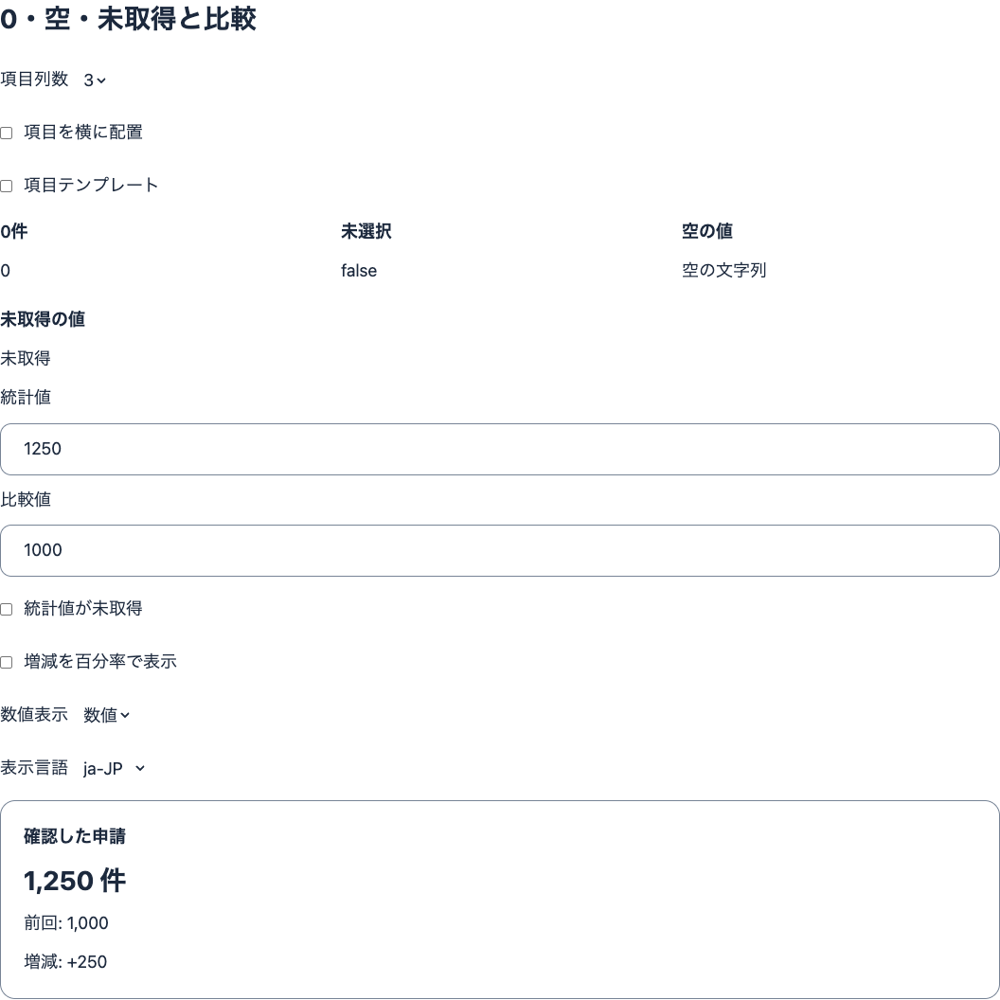 | 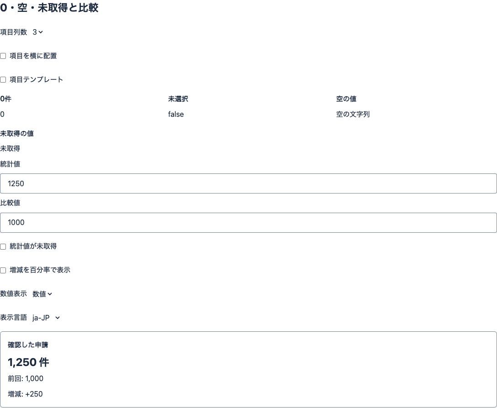 |
| 整形／コピー失敗・1280px | 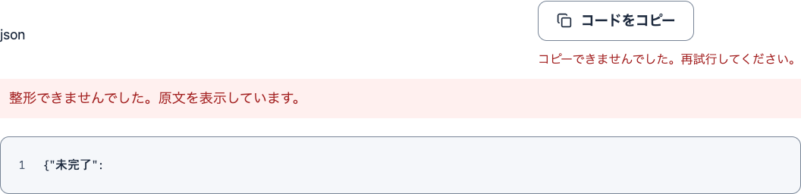 | 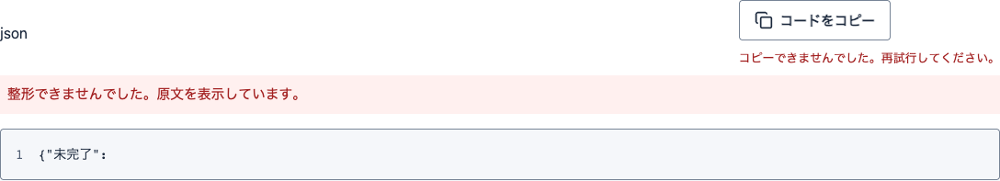 |
| 全文の保持と展開操作 | 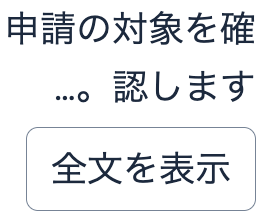 | 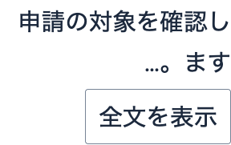 |
| 透かし内の入力と操作 | 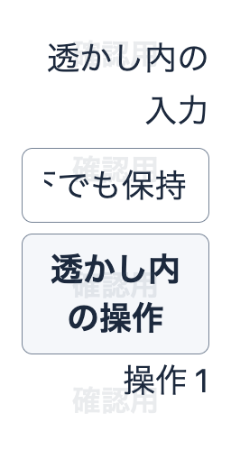 | 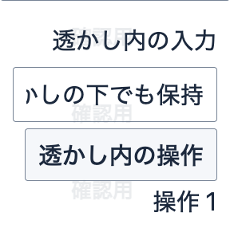 |
| 折返し／空行と行番号 | 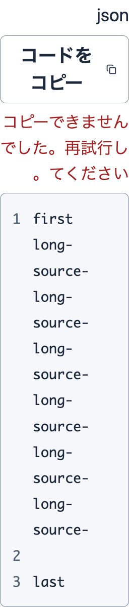 | 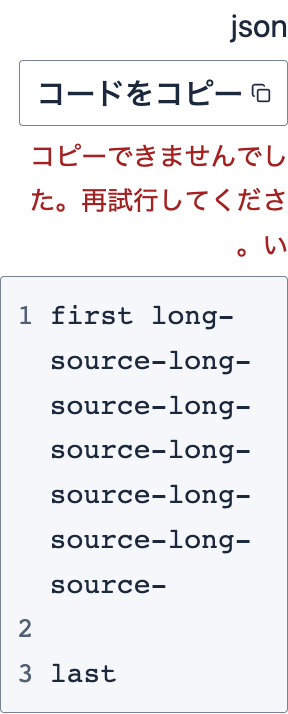 |
| 祖先RTL／自前LTRのBadge中心 |  |  |
| 小数Meterの量／単位／上限 | 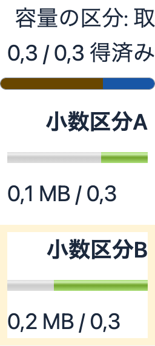 | 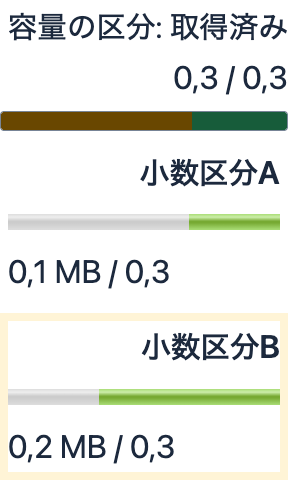 |
| small Avatarの代替文字 | 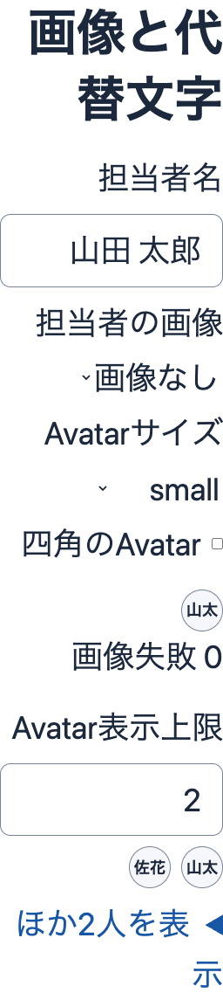 | 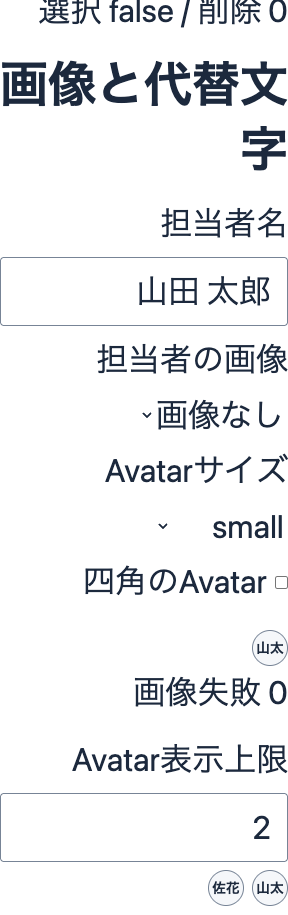 |
| コピー応答待ちのfocus | 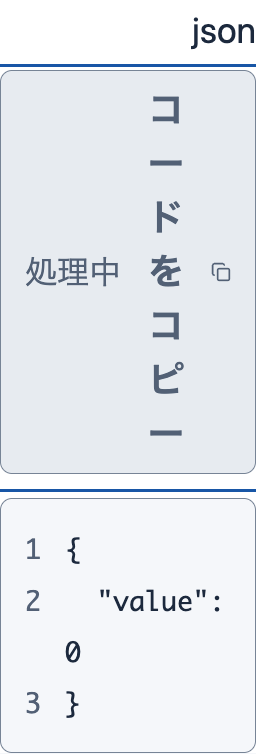 | 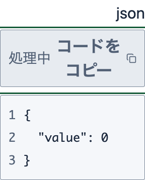 |

最初の2行以外は320px／文字200%／RTL／reduced motion。画像だけで全操作や支援技術の成功とは判定せず、操作試験と独立レビューを別に記録する。

## 進捗と限界

全181要求の確定進捗は88 verified／16 partial／77 pending。今回の11表示行を全検査と独立最終判断の後にverifiedへ更新した。全カタログは未完了。フォーム／ナビ／浮動表示／一覧・表／メディア／専門部品・基盤の残件は継続する。出力変更時のSkill所有情報喪失P2は固定出力の同期を妨げていないため、出力移行の別修正として残す。

GitHub Actions設定はなく、CI合格とは扱わない。実screen reader、Safari／Firefox、OS touch、SSR、人の業務評価は未実施。Undo／backend更新／永続化／安全な継続は利用アプリが所有する。npm公開、有償契約、OSセキュリティ設定変更は行っていない。
