# 端の領域・浮動表示6要求（2026-10-05）

PR #7のコード/試験HEADは `7475ce3566699680d60beb1ac192e6b35d06a181`、baseはPR #6 merge `01a95d8548e71cfa51be04eafae8fa4b07c351d8`。専用branchで作業し、ユーザーのlocal mainや他の差分をresetしていない。対象はoverlays-05..10。全181要求と原文の制御項目を残す。

## 実装と責任範囲

Drawer/BottomSheetはnative Dialogのslots、modal/終了条件、終了理由/同期保留、busy、move/resize/maximizeを再利用する。Drawerの4辺は物理位置、専用semantic size.drawer-inline/blockと正の明示pixel寸法。Sheetは昇順比率による高さとnative buttons/rangeで段階を変更し、同じ入力DOMを保つ。hidden/inert/切離しではnative closeでmodalを解放し、利用不能scopeを終了保留で延命しない。

Popover/Tooltip/HoverCard/ConfirmPopoverは実HTMLElementの対象とnative popoverのtop layer、6種の配置/反転/viewport制限、click/hover/focus/manual、対象/元DOMのprofile/RTL/modal所属、owned ARIA/focusを持つ。Popoverはtyped header/body/actions、Tooltipは説明だけ、HoverCardはTab/Enter/明示clickで補助操作へ入る。timer/observer/listener/ARIAは対象変更や破棄で後始末する。

ConfirmPopoverのconfirmRequestedはUIの意思。アプリがbusy/error/retryと結果後のcomplete/open=falseを所有する。保存、実Undo、業務上の継続判断を先取りしない。破棄による入力DOMの終了と、閉じて開く際の保持を区別する。アプリがopen=trueを維持して明示再作成した場合は再度開く。

共通OverlayのEscapeをdocument bubbleへ移し、入力のpreventDefaultとIMEを優先する。native CloseWatcherは直前の操作がない連続した終了要求でnoncancelableになり得るため、キー契約をnative cancel拒否だけへ依存させない。native Dialogのinertness/Tabと、OS戻るなど非キー終了の制限は[ADR](../adr/0001-overlay-escape.md)へ記録した。非modalの外部focusを奪わず、自前focusだけを復帰する。

## 独立レビューと修正

fresh reviewerがexact base/headの実diff、周辺source、正本/生成/Skill、別生成consumerとroot画像を読み、専用ブラウザで操作した。e373ではcore14シナリオ/88観測、edges12/84、既存Menu/Combobox4/12が通過した。

- 表示待ちTooltipだけが処理済み/合成IME Escapeを取消へ使うP2を両profileで実再現。修正前6回帰はすべてhiddenで失敗、修正後は未処理キーだけで待機を取り消す。
- bodyだけの監視ではhtml.dir変更後にanchorとPopupの位置が776/808pxずれた。またhtml.inert変更後、Drawer/Sheetのmodalと既存Menuのpopupが残った。根を含むdocumentElementの監視へ修正した。root RTLの2件とroot inertの6件は修正前に実失敗し、修正後は配置追従・native/modal解除・scope復帰後のoutside focusと入力保持が成功した。
- 320px/文字200%の描画で見出しとSheetラベルが細い列へ折返したため、semantic文字サイズによるflex basisを付けた。修正後に72浮動操作と16描画を再実行した。

旧e373の全検査は設定64/生成15/モデル47、UI467成功/1失敗で実終了1。既存MaskedInputの設定変更→focus/Tab試験で値12が残った。同コードの10回反復は10成功。両profileの調査用Angular dev APIでは、同event turnでparent signal=true/child input=falseのままnative blurすると12を保持し、子への反映後のreal Tabでは空値となった。失敗traceには子の設定値を採取していないため、元runの描画競合は推定とする。fixtureの実設定説明を動的にし、試験が説明のDOM反映を待ってからTab/OTP focus/空値を確認する。MaskedInputの製品sourceは変更しない。

新HEADで独立18scenario/90観測（表示待ち10対照含む/根RTL-profile-style2/根inert Drawer-Sheet4/共通Menu2）が通過し、P2三件を解消した。元30scenario/184観測と合わせ、48scenario/274観測。隠れた入力をrole queryが除外したreview harnessは保存済み実Elementへ修正し、根inertの部分28観測でnative/modal解除、native理由、外部focus/操作、同じ入力DOM/値、再open/次のEscapeを確認した。sourceへの追加変更はない。

独立axe18状態はviolations=[]、runerror/pageerrors=[]。incompleteのaria-valid-attr-valueはcontrolsWithinPopupの判定で、38 node-occurrence/4 controls ID。全aria-controls/describedbyの108参照occurrenceについて実DOM存在とunique=1を別に照合した。color-contrastの17 node-occurrenceはすべてelmPartiallyObscuringで、top layerの重なりで背景色を自動確定できない箇所。自動判定不能を全面アクセシビリティ合格と扱わない。

最終判定はapprove、未解決P2以上なし。コード/Skillのread-only再計算63項目とmanifest62 SHA、configHashが一致。描画16 SHAもe373で観測したものと全一致した。reviewerも新全runのHEAD/実.exit=0/UI482 summaryを読み、source不変を確認した。

## 検証

固定7475の全npm testが実終了0。設定64・生成15・モデル47・UI482（10.6m）、全608件が成功。sync/check/strictTemplates/AOT・別生成production consumerを含む。新16回帰も実終了0。先行するe373の170回帰/72浮動成功や旧全runの1失敗と、新HEADの成功結果を混同しない。

別出力で生成したproduction consumerは6部品、typed PopupTemplate、native Dialog/Popover、入力保持/段階操作/確認意思を使い、不正context propertyをAOT/strictTemplatesで拒否する。新入力の合成compositionと調査用native focusはOS IMEの認証ではない。

浮動UIの84試験と既存Overlay46試験は、slots/同DOM/owned focus/target変更、遅延/取消/ARIA、preview Tab/Enter、confirm busy連打/error/retry/app結果、native edge寸法/physical RTL、hidden/inert/段階/busy、child key/IME、入れ子/連続Escape、320px/200%/RTL/reduced motion/axeを観測する。

補助ログは/tmp/ui-foundation-floating-full-fixed.head/.log/.exit、floating-review-fixes.log、floating-pending-before.log、floating-root-before.log、floating-inert-before.log、floating-drawing.json、mask-binding-probe.jsonとreviewer専用記録。実repoの証拠は試験source、本書と画像。

## 描画

rootとreviewerが両profileの16枚をすべて開いた。1280pxと320px/200%/RTL/reduced motion、runtime errors=[]、ページ全体の横overflowなし。入力保持とnative Popup→親Dialogの独立Escape、確認error、段階変更を実操作した。画像はe373で記録し、7475はキー/根observer/旧フォームfixtureの差分で、浮動CSSと示した内容は不変。最終全runと独立delta確認を別に記録する。

| 内容 | guided | dense |
| --- | --- | --- |
| 全体・1280px | 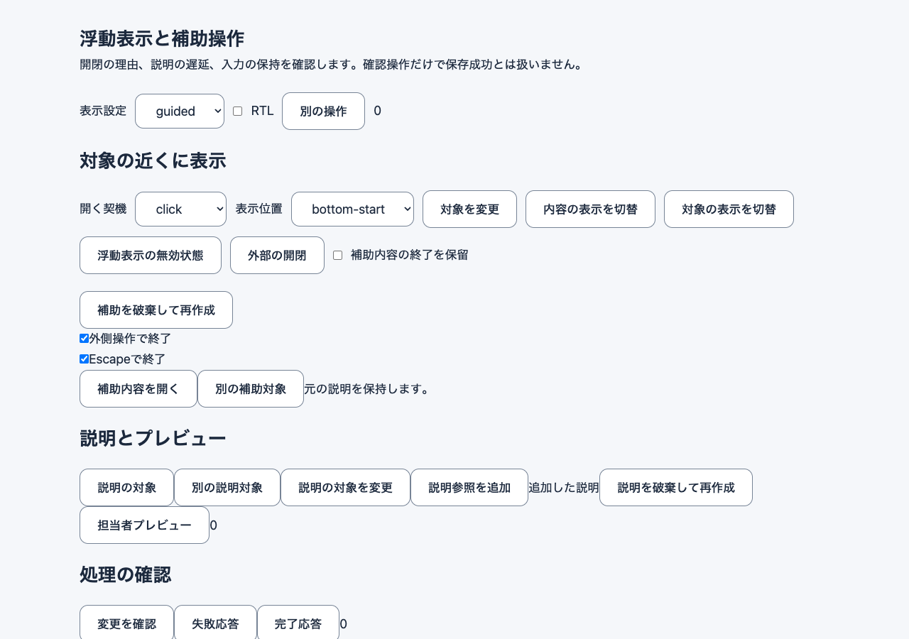 | 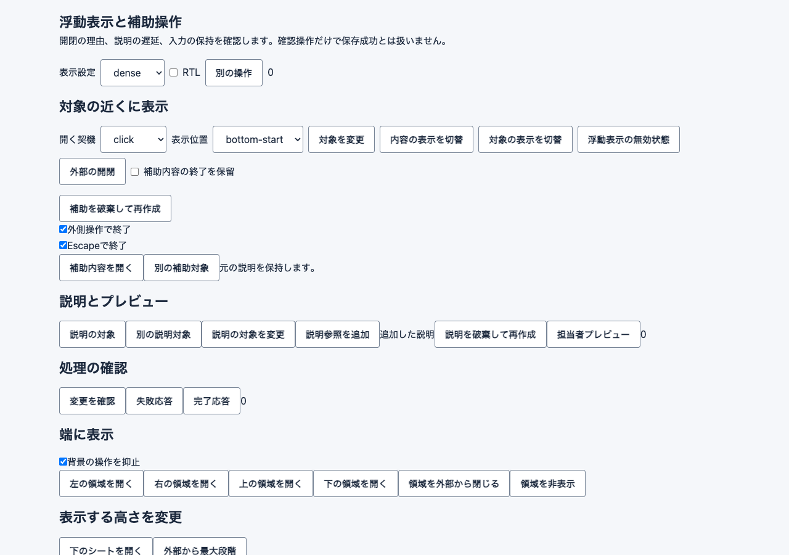 |
| typed Popup・1280px | 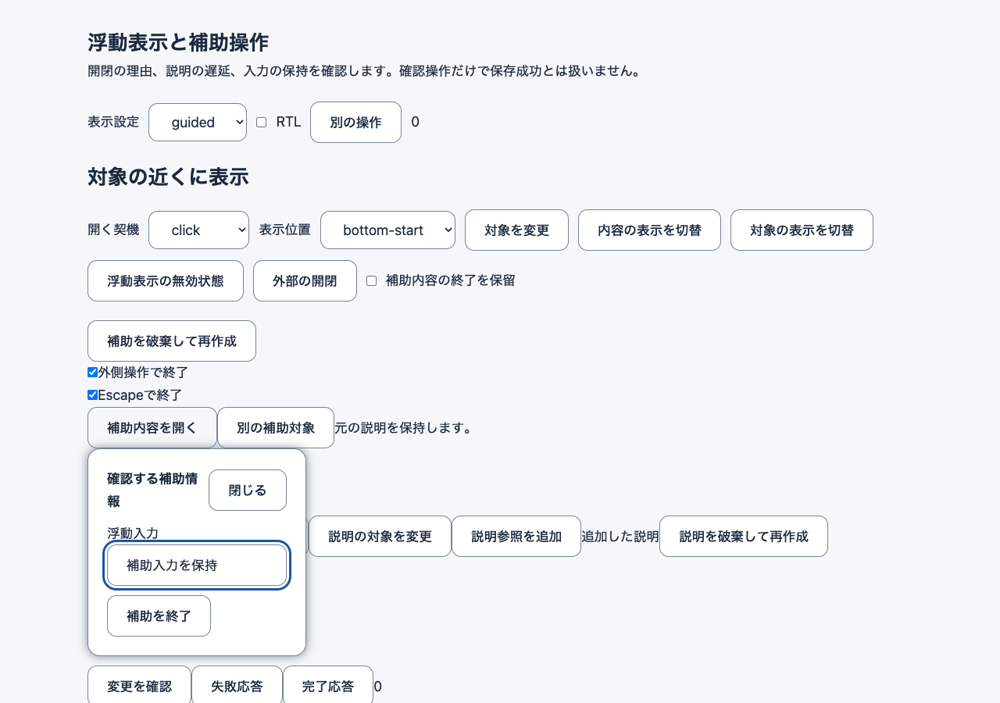 | 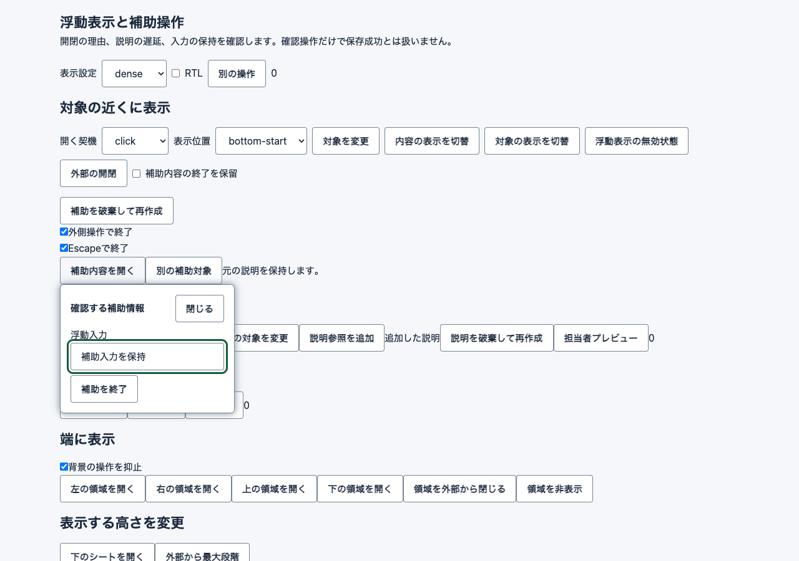 |
| 説明と対象focus・1280px | 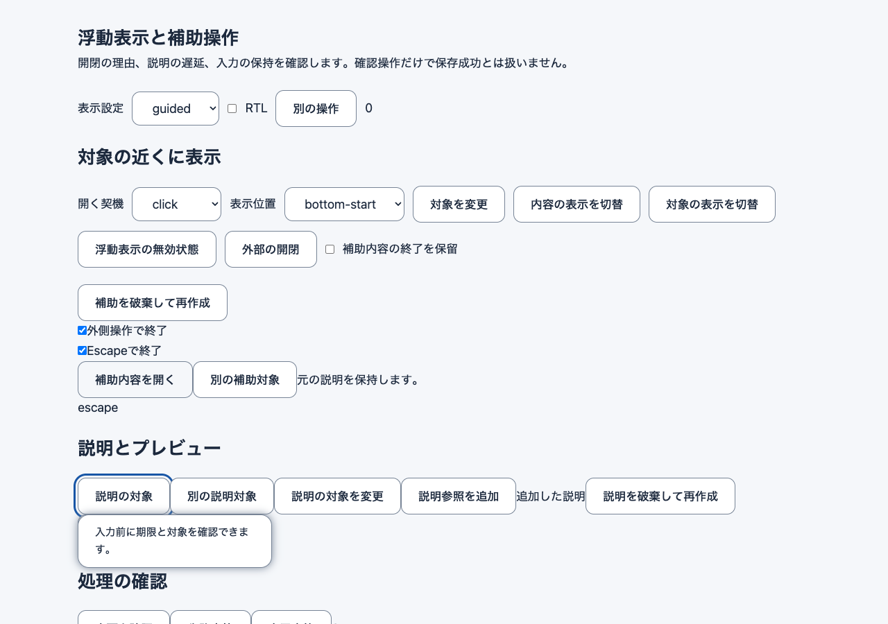 | 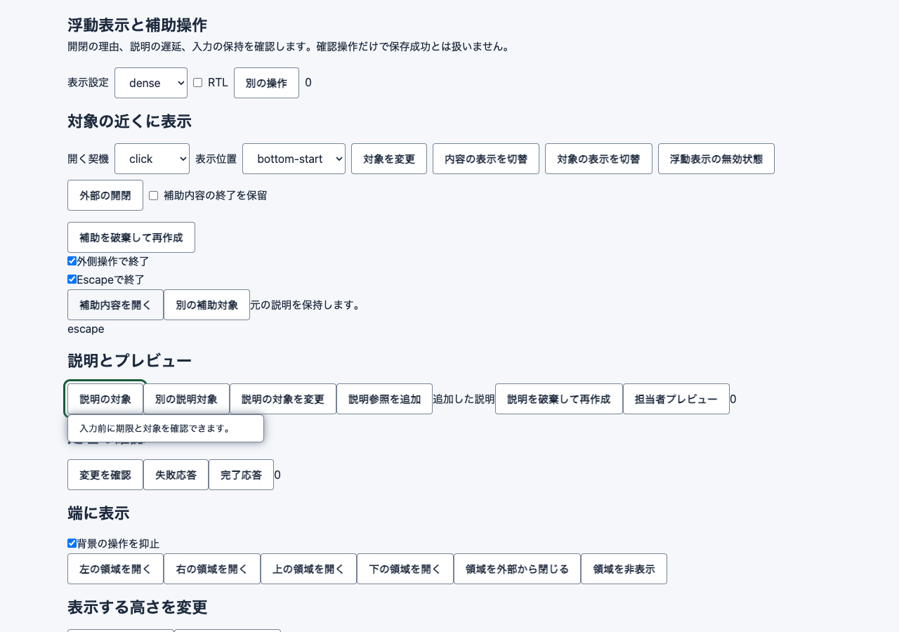 |
| Previewの補助操作・1280px | 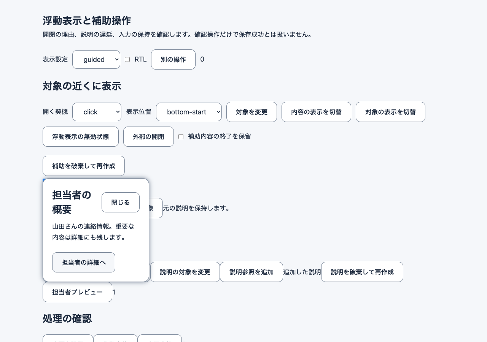 | 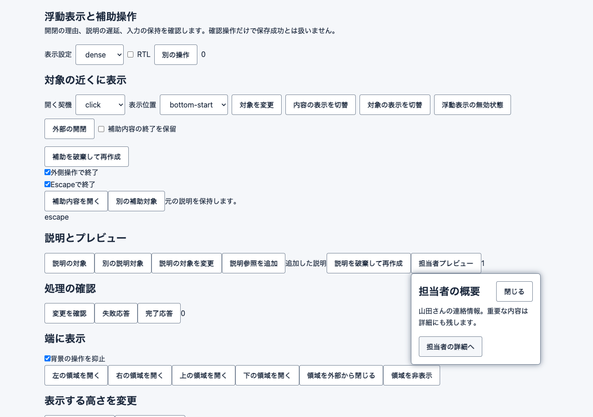 |
| 確認失敗と下書き・320/200/RTL | 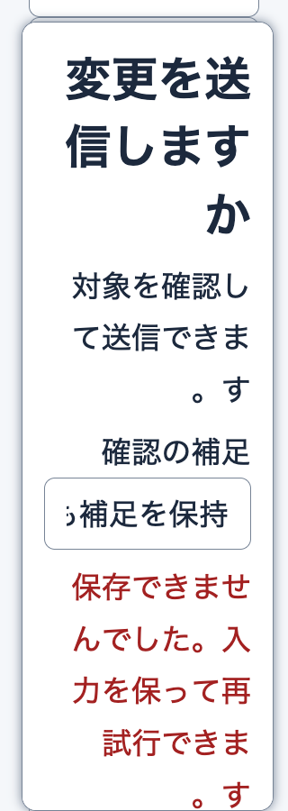 | 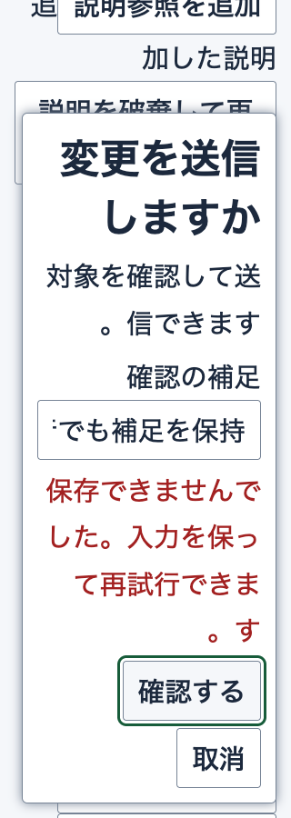 |
| 終了保留のDrawer・320/200/RTL | 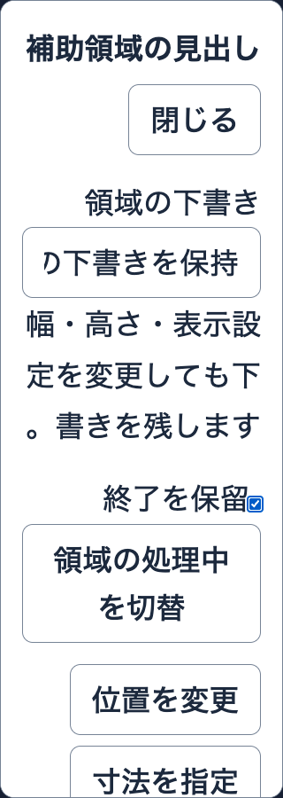 | 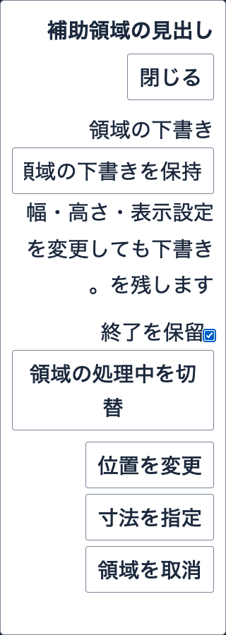 |
| 段階変更のSheet・320/200/RTL | 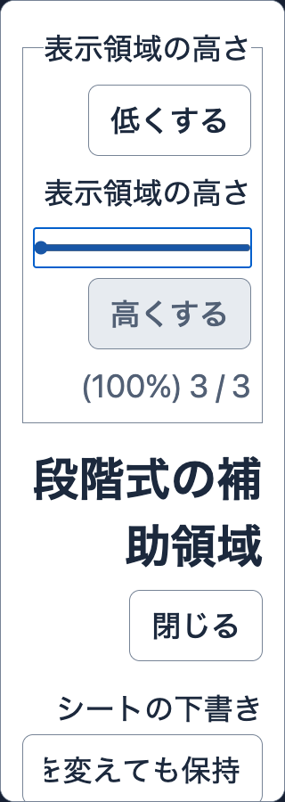 | 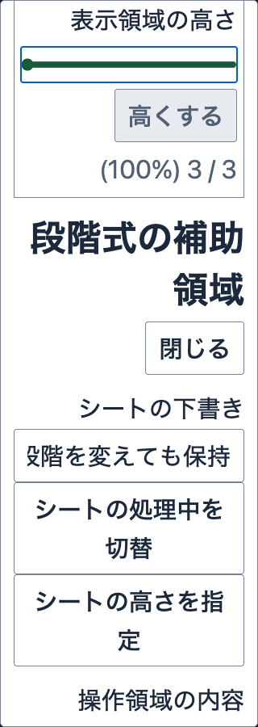 |
| native modal内のPopup・320/200/RTL | 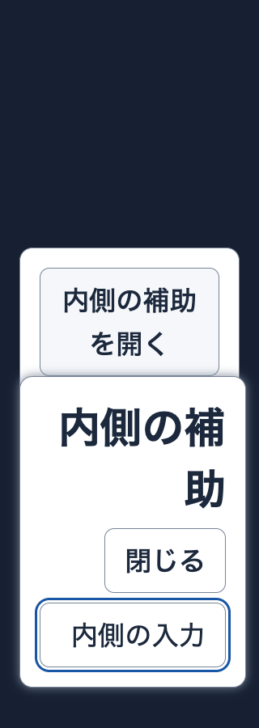 |  |

拡大時の長い内容は内部scrollで操作へ到達する。1枚で全情報が収まるとは扱わない。写真と操作/自動axe/人の理解は別の証拠。

## 残件と限界

新6行をverifiedへ更新し、全181要求の確定countsは105 verified/11 partial/65 pending。全依頼は未完了。残ナビ/一覧・表/virtualization/dragdrop/フォーム・予定/媒体/専門部品/locale・profile基盤を続ける。output移行時Skill所有情報の既知P2は固定出力の同期を妨げない別残件として保持する。

GitHub workflow/status/review_threadsは0。CI、実screen reader、Firefox/Safari、OS IME/touch、SSR、実backend/Undo、人の業務評価を成功と表現しない。新依存・有償契約・npm公開・OS設定変更はない。Mac appのPR添付はTransport closedで成功未確認、GitHubのPR/Issue操作とは区別する。
