# フォーム基盤・構造化入力11要求（2026-10-05）

PR #6のコード/試験HEADは `0c39c4e0739417fdb33b16b5e3f287b3d6440b0d`、baseはPR #5 merge `e58c8da1394444a13263e91f632f0e02dcbe635a`。origin/mainから専用branchを作り、ユーザーのlocal mainや他の差分をresetしていない。対象はforms-01/02/05/07/09/10/11/12/13/17/28。他カテゴリを削除せず、全181要求のmatrixを保持する。

## 実装・利用アプリの責任

FormFieldのラベル配置をFormLayout/FormGroupで継承し、専用semantic `size.form-label`を正本YAML/schema/profile/生成/Skillへ接続した。FormGroupはnative fieldset/legend、FormActionsはnative submit/resetとcancelの意思表示。fieldsetのnative disabledとAngular validationから除外するform.disable()を区別する。nullable resetの値は利用アプリのFormControl設定に従う。

Textareaは幅/profile/hidden復帰で高さを再計算する。SearchInputはquery+requestIdで同じ検索語の古い応答を除外し、同値resetも待機中debounceを破棄する。CheckboxGroupの方向/列数とRadioGroupのnative矢印/CVAを追加。typed ComboboxOptionとnative popoverを共通Overlayへ接続し、modal内で候補を閉じた直後のEscapeをDialogへ渡す。

MaskedInputは1グラフェムごとの文字slotとASCII数字を扱い、raw CVA値・固定区切り付き表示・未入力部分を分ける。不正draftを残し、以前の値でvalidを偽装しない。区切り削除/再入力、IME、UTF-16 caret、途中入力の保持/明示clearIncompleteOnBlurを扱う。OTPは先頭0と全コードを保持し、桁超過を切り詰めない。one-time-codeはnative DOM契約で、OS自動入力や認証の成功を保証しない。TagInputはcollectionの必須/候補/重複/上限を検証し、未追加draftと不正な復元値を修正用に残す。busy・値差替え・削除では自前focusだけを保持し、別の操作のfocusを奪わない。

backend保存・認証・実Undo・送信/取消の結果・日時の業務解釈はアプリが所有する。[API契約](../ui-components.md)を参照する。

## 独立レビュー

fresh reviewerがexact base/headの実diff・周辺source・contract・Skill・config・consumerを確認。旧f9のA/* slotは単一Unicode Letter+Marksだけを受理し、分解Hangul/Indicの複数Letterを含む1グラフェムを拒否していた。両profileの実ブラウザで、가は受理、가/क्ष/ক্‍ষはdraft保持/invalid=true/以前のraw値保持を再現したP2。

文字slotを1グラフェム内のLetter/Mark/必要なjoin controlへ修正。新モデル試験は修正前exit1（null !== 가山01）、修正後exit0。新UI2件を追加した。reviewerは修正HEADを読み直し、両profileの14結果で元コードポイントのまま受理/書式表示、emojiや不正数字の拒否draft保持を独立確認した。

独立なコードHEADの判定はapprove、未解決P2以上なし。Unicode14入力結果に加え、両profileの主要44観測を行った。即時読取8件はAngularの描画前だったため、DOM完了を待った追加10観測で該当経路を再確認し成功した。Radio再有効化後の矢印、Checkbox値保持、Textareaのhidden/profile復帰、Comboboxの選択表示と320px/200%/RTLを確認し、描画待ちのprobe失敗を製品不具合に数えない。reviewerは59生成物のhashとsource/Skill/profile一致、rootの全518ログと実exit0を独立読取した。build/全suiteはroot、独立ブラウザの操作はreviewerが行った。

## 実行した検証

固定コード/試験HEADの全npm testが実終了コード0。設定63・生成15・モデル44・UI396、計518件が合格（UI8.4m）。ui:check、strictTemplates/AOT、別出力のproduction consumerを含む。consumerはform/CVA/native actions/typed ComboboxOptionを使い、不正なtemplate propertyをcompileで拒否した。

フォーム54操作は両profileでraw/formatted/桁超過/IME/一括paste/Unicode/削除と修正、拒否draft/値復元、CVA disabled/readonly/reset、radio矢印、columns/label/profile/同じnative DOM、autosize、同じ検索語のrequest IDと同値reset、native popover/modalの連続Escape、busy focus/別領域focus、320px/文字200%/RTL/reduced motion/axeを検査する。OTP貼付の新試験は明示ClipboardEventの入力経路であり、OS自動コード入力の実証ではない。全suiteの既存実Clipboard検証と分ける。

旧f9の全検査はMac実行接続断でUI213/394まで記録されて中断、終了summary/exit0なし。生成15/設定63/モデル43を含む部分結果を全成功に数えなかった。自身の孤立した4183 serverだけを停止し、source/testを固定し直して上記518へ再実行した。新runはPID/ログ/実npm終了コードを保存する独立プロセスで実行し、失われたsessionの完了を推測していない。

開発中のfixture起動selector、native maskの途中挿入、popupを閉じた後のEscape、nullable radio resetの期待値を修正した。clock停止時のAngular描画待ちと日本語keyのtest API誤りも訂正。失敗/中断した開発runを一括合格とは扱わない。描画probeの初回はbusyラベル変更後のselector不一致で失敗したため、data-form-actionの固定selectorで再実行した。

補助記録はMacの `/tmp/ui-foundation-structured-full-0c39c4e.log` / `.exit`、`/tmp/ui-foundation-forms-unicode-ui.log`、`/tmp/ui-foundation-forms-drawing.json`、`/tmp/ui-foundation-review-unicode-0c39c4e.json`。リポジトリの証拠は試験source・本書・下記画像。

## 描画

修正コードHEADの両profileで14枚を記録し、rootは全14枚を開いた。runtime errors=[]、横overflow=false、書式エラーとOTP桁超過/タグdraftを保持、処理中は操作領域にfocusを残し、終了時に自前submitへ復帰。native popover/modalの選択/Escapeと入力保持を実操作で確認した。

| 内容 | guided | dense |
| --- | --- | --- |
| 有効な値とnative送信・1280px | 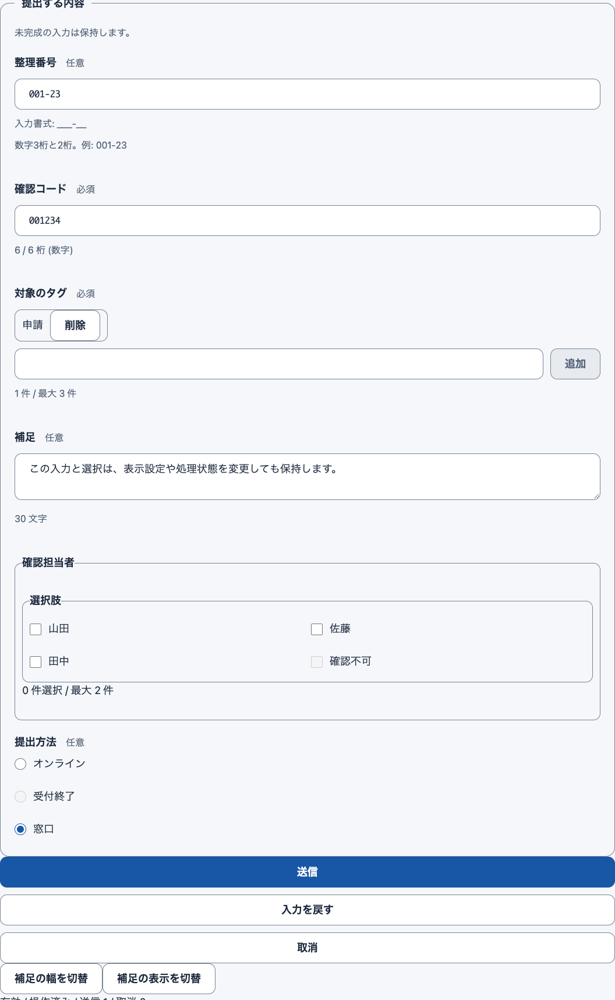 | 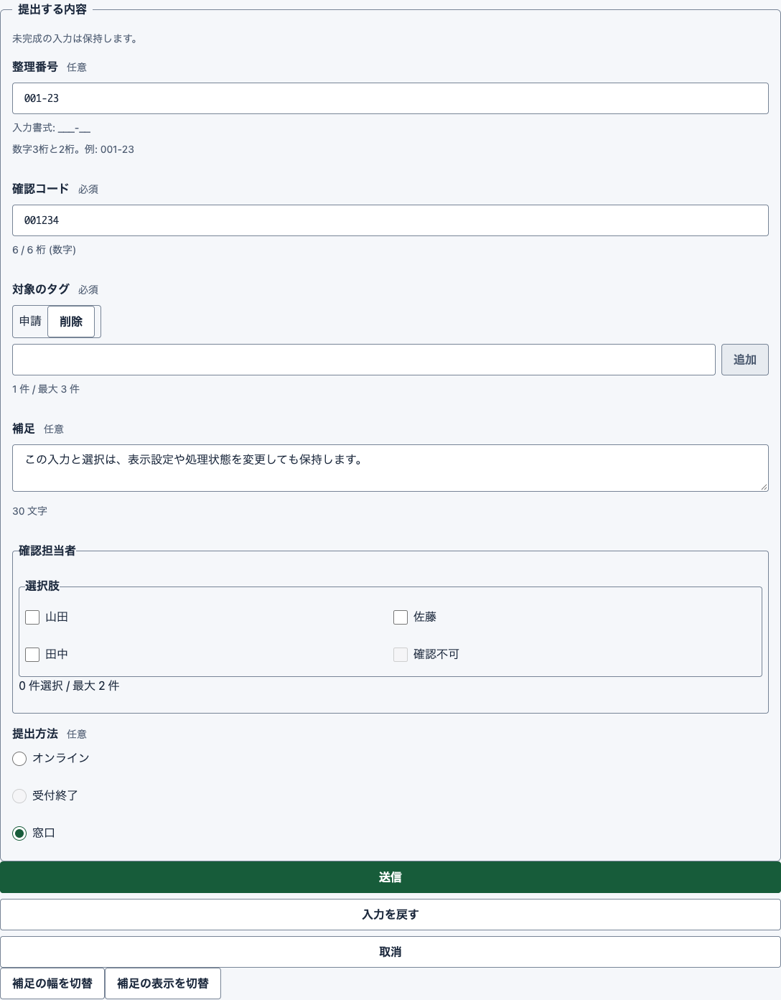 |
| ラベル配置と入力保持・1280px | 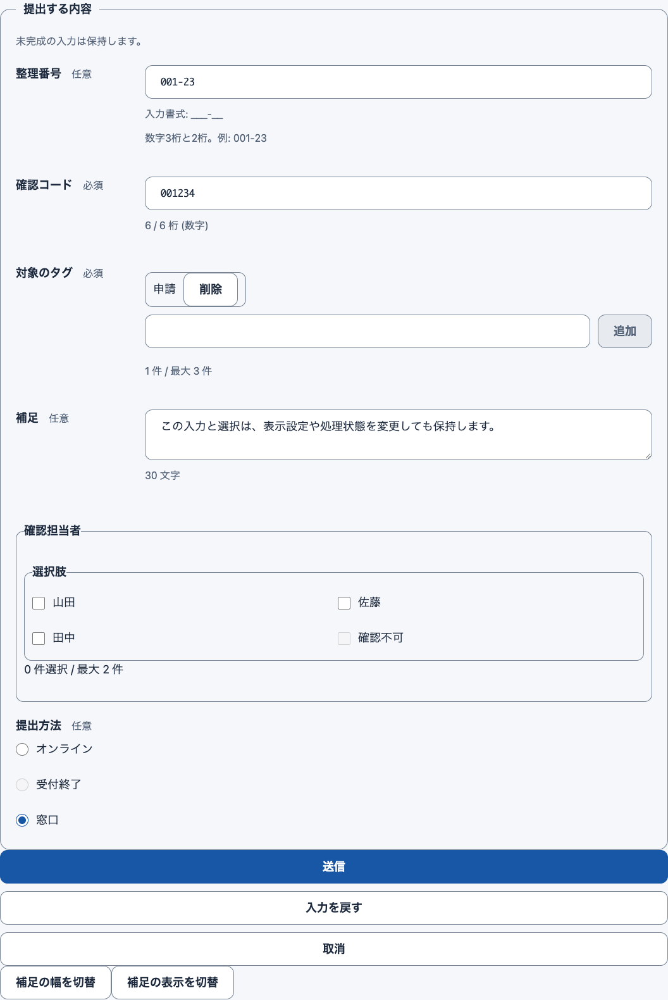 | 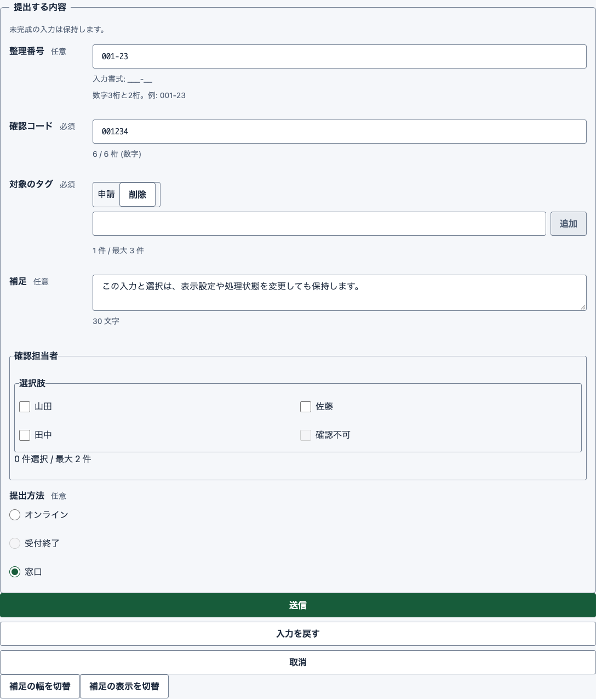 |
| 不正書式・桁超過・重複の保持 | 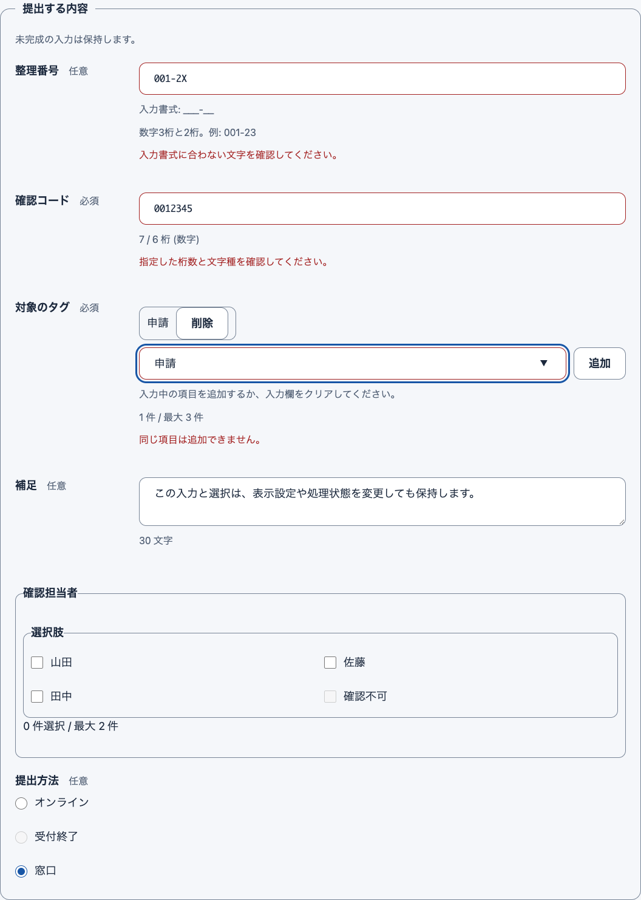 | 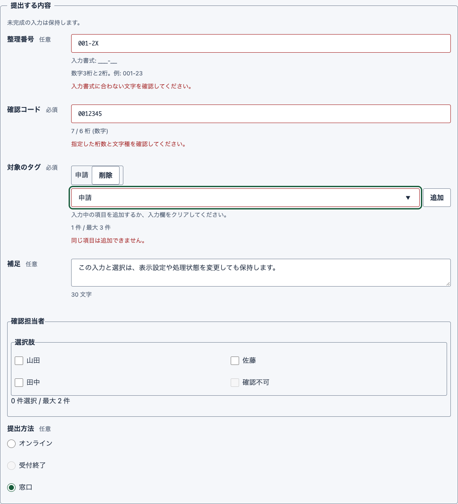 |
| 320px/200%/RTLのエラー | 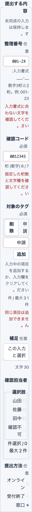 | 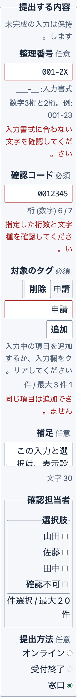 |
| 対象を保持するnative popup | 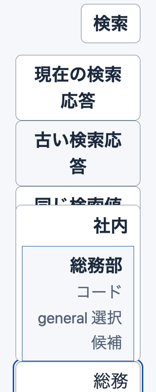 | 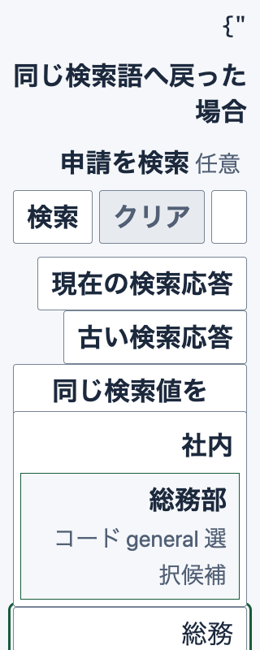 |
| native modal内の候補 | 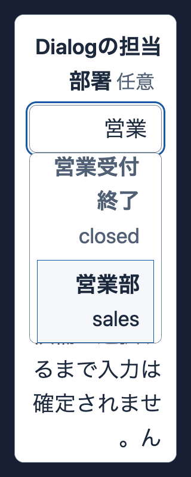 | 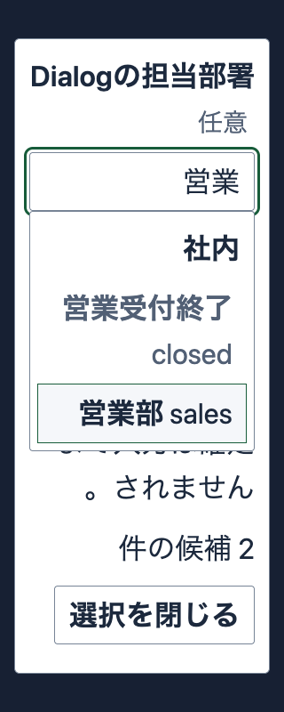 |
| 処理中の操作とfocus保持 | 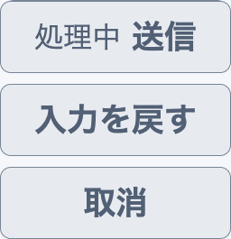 | 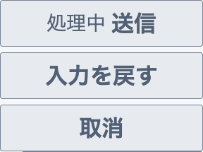 |

最後の4行は320px/文字200%/RTL/reduced motion。guidedの拡大時はsemantic page余白で本文が狭まり、長文が多く折返す。画像をkeyboard/支援技術/利用者理解の全体証明に使わず、操作とaxe・独立レビューを分ける。

## 進捗と限界

今回11行をverifiedへ更新し、全181要求の確定countsは99 verified/11 partial/71 pending。全カタログは未完了。残フォーム/ナビ/浮動表示/一覧・表/媒体/専門部品・基盤を継続する。既知output移行のSkill所有情報P2は固定出力の同期を妨げず、別残件として追跡。

GitHub workflow/statusは0、CI合格とは扱わない。実screen reader、Firefox/Safari、OS touch/自動OTP、SSR、実backend/Undo、人の業務評価は未実施。新依存・有償契約・npm公開・OSセキュリティ設定変更はない。Mac appへのPR添付はTransport closedで成功未確認であり、GitHub PR/Issueの作成/更新とは分けて報告する。
