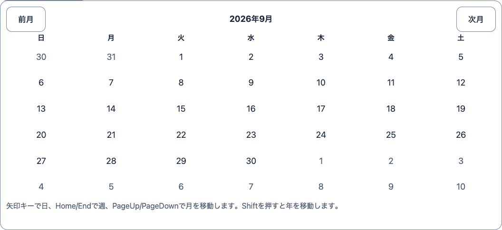
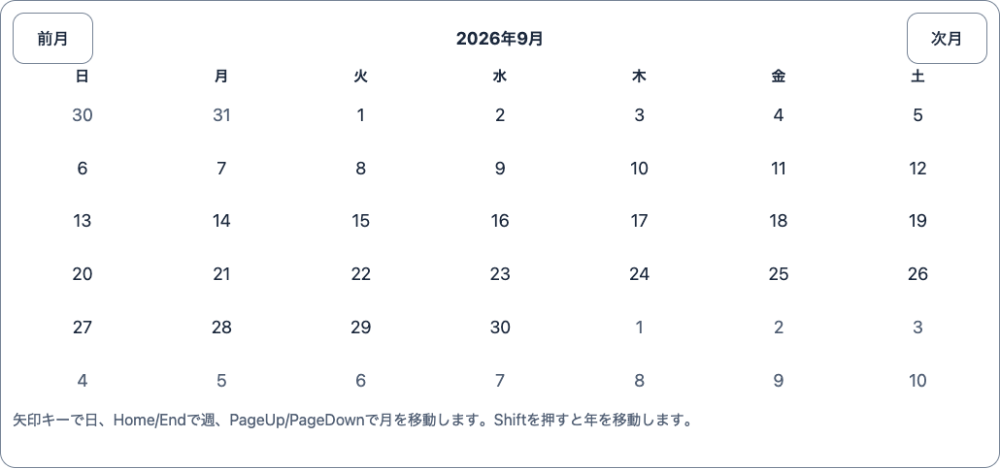
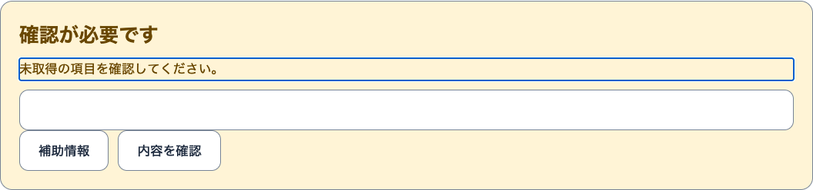
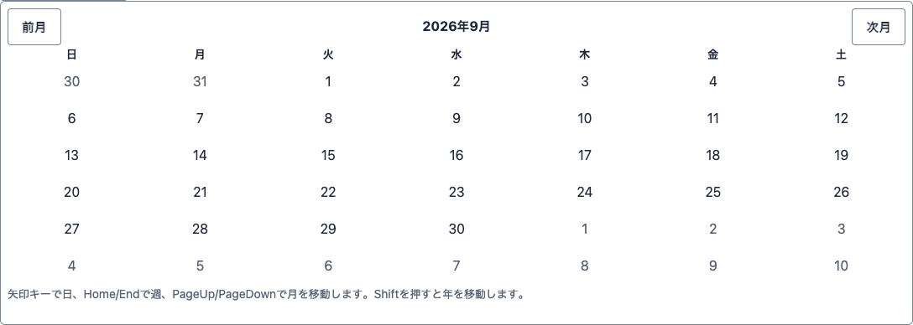
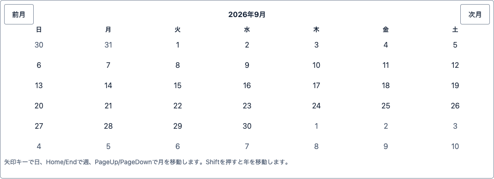
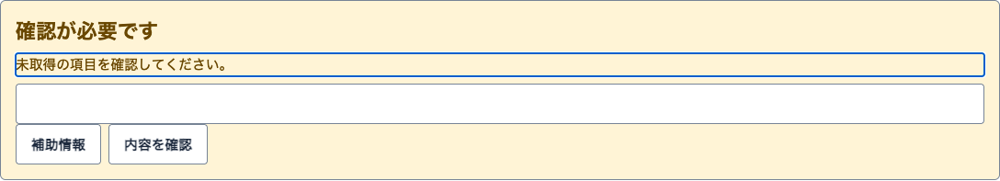

# ローカル日付の既定値とAlertのフォーカス修正（2026-10-05）

PR #4のコードHEADは `91107d1fa5c74ff639463511203641750958b2c4`、baseはPR #3 merge `ad37e61496a7fe9707e9057151702d678009e25b`。ユーザーが更新したmainとorigin/mainは同コミットで、未コミット差分なしを確認して専用branchを作成した。前回失敗したfetchは再実行せず、今回の通常の実行審査は通った。

## 修正の意味

- Calendar.todayとDateRangePicker.initialMonthの省略時だけ、部品作成時の端末ローカル日付／月を使う。東京の月初00:30とロサンゼルスの前月23:30を、UTC日付に置換しない。確定済みcivil値、日付のUTC演算、明示today／initialMonth／selected valueを保持する。業務タイムゾーンと午前0時の更新はアプリが明示値を渡す。
- Alertの確認／閉じる操作が外部更新で除去される場合、その操作にあったfocusを本文へ移す。別の残る操作・補助入力・領域外のfocusは保持する。
- 独立レビューで、処理中の親が投影した子feedbackのfocusを奪うP2を再現。blockedとremovedの両方を、親の直接配置された組込み操作だけへ限定した。投影操作のbusyと処理結果はアプリが所有する。

## 実行済みの証拠

最終コードを固定した `npm test` がexit 0。設定60・生成15・モデル25・UI300、計400件が合格（UI 7.7m）。ui:check、型検査、strictTemplates/AOT、fixture build、別出力のproduction consumerを含む。別生成consumerでは自然な入れ子投影のfocus保持・Enter出力と、自前close除去の本文focusを両profileで操作した。不正row propertyのcompile拒否も実行した。

月境界とAlertの回帰8件は別途合格。Asia/Tokyo／America/Los_Angeles×guided/denseの既定日・月・選択・profile保持と、Alertの外部更新、残るfocus、自然な子Alert投影を確認。従来の狭幅・200%・RTL・reduced motion・axe・timer・keyboard・保持／復旧の回帰も全UI検査に含む。

fresh-context reviewerはbase/headの実diff、周辺コード、API／Skill、試験、生成物とmanifestを読んだ。Chromeで自然なui-inline-message投影を独立操作し、guided/dense双方の親busy中の外部除去後focus、Enter出力、runtime error／warningなしを確認。最終コードの判断はapprove、残るP0/P1/P2/P3なし。reviewerはbuild／sync／試験を実行しておらず、試験結果はrootが実行し確認したログと区別する。

以前の `ebfbf5c` の全398合格は最終HEADの証拠へ置き換えない。そこで見つかった投影focus P2を修正し、コードと試験を固定して全400件を再実行した。描画6枚は最終コードの実ブラウザーから保存し、rootが全て開いて確認した。描画記録はruntime error／warningなし。

実行ログ: `/tmp/ui-foundation-local-defaults-full-91107d1.log`、対象回帰: `/tmp/ui-foundation-local-defaults-scoped-targeted.log`、描画記録: `/tmp/ui-foundation-local-defaults-drawing.json`。これらは今回のMac実行の補助記録で、リポジトリに含める証拠は試験ソースと本書／画像。

## 描画

1280px、America/Los_Angeles、`2026-10-01T06:30:00Z`（端末ローカル2026-09-30）。Calendarと期間の最初の月が9月になる。Alertは組込みcloseを外部で除去した後の本文focus。期間の第2月が10月になることは操作検査でも確認した。

| profile | 既定Calendar | 期間の第1月 | Alert本文focus |
| --- | --- | --- | --- |
| guided |  |  |  |
| dense |  |  |  |

## 完了範囲と残件

このPRは既存機能の修正。全181要求行は77 verified、16 partial、88 pendingで変わらず、全カタログは未完了。既存の出力先変更時Skill所有情報喪失P2は今回の固定出力syncを妨げていないため、別の出力移行修正として残す。次は文字・情報・数値表示11行へ進む。

GitHub Actions設定はなく、CI合格とは扱わない。実screen reader、Safari／Firefox、OS touch、SSR、人の業務評価は未実施。Undo／backend更新／永続化／安全な継続は利用アプリが所有する。npm公開、有償契約、OSセキュリティ設定変更は行っていない。
