# ナビゲーション・操作検索9要求（2026-10-05）

PR #8のコード/試験HEADは `9d8840e45b7f863d2095a51aa4a93ead0ab1a220`、baseはPR #7 merge `298fb3653e1008f1a55d6a723cedc903779476e4`。専用branchで実装し、ユーザーのlocal mainや他作業をresetしていない。対象はnavigation-01..06/10..12。全181要求の原文と制御項目を保持する。

## 実装と責任範囲

Navigationはnative nav/list/linkと現在地、縦横・狭幅の折返し/局所scroll、Icon投影を持つ。SideNav/Railはnative details/summaryの再帰階層、展開・折畳み・幅・親href・現在地を保持する。Dockは平坦なnative links、ラベル・Icon・4辺の固定位置、ラベル非表示時の説明を持つ。階層をDockに混ぜる設定は明示拒否し、SideNavを使う。Breadcrumbは長い中間階層をnative detailsへ入れ、全移動先へ到達できる。

Tabsはmanual activationの縦横/RTL/disabled、局所scroll、閉じる/並べ替えの意思、最後のpanelの明示fallbackを持つ。アプリが安定idで実際に並べ替え・除去し、同じnative editorと入力を保持する。未保存の終了保留と現在地/Router/URLの業務判断はアプリが行う。

AnchorNavigationは実HTMLElementと同一documentのscrollRoot、native hash、実scroll、見出しfocus、現在位置、static/sticky/fixedを持つ。offsetとscrollportのscroll-padding-block-startを移動・追跡に合わせ、px/%/calcを扱う。複雑なCSS算術はnative layoutで解決する非操作の補助要素を再利用し、破棄で除去する。margin/tabindexの一時変更は所有値だけを戻し、CSS priorityと途中のアプリ変更も保持する。固定領域の予約は画面が実高さから確保し、デモはResizeObserverで予約と解除を行う。

Menubarは水平rootのroving/RTL/typeahead/Home/End、再帰Menuの3階層とcheck/radio、親focus復帰、全体のTab退出を接続する。group/separatorはpopup内、rootは操作項目とする。MegaMenuはnativeリンク/階層を分類・見出し・補助説明・可変列で表示し、全リンクへTabで到達する。狭幅では見出しと閉じる操作を別行へ折返す。

CommandPaletteはnative Dialog内の検索combobox/listbox、分類・AND検索・shortcut・操作履歴、busy/失敗/再試行を持つ。pendingで連打を抑止し、検索/入力DOMを保持する。履歴は呼出意思の履歴であり、実行成功や永続保存を意味しない。実command/結果/履歴保存はアプリが所有する。shortcutは実focusが属するactive native modalに合わせる。

semantic size.navigation-rail/mega-menu/navigation-columnをroles→YAML正本→生成token/Tailwind/contextへ接続した。primitive参照や旧API互換層を追加していない。

## 独立レビューと修正

fresh reviewerがexact base/headの実diff、入口文書・設定正本・Skill・生成物・consumerと実描画を確認した。初回f9はP1 1件/P2 1件でrequest changes。修正後も画面の予約余白・CSS priority・現在位置を実操作で調べ、次の7件を修正した。

- R1/P1: 最初のDOM modalだけを見てshortcutのscopeを誤判定し、内側の確認からPaletteがfocusを奪った。実activeElementの所属modalを優先し、内側を閉じてからだけ起動する。
- R2/P2: 閉じたnative details内のtargetにhref/aria-disabledが追従しなかった。open監視とtemplateの直接revision購読を追加し、閉鎖→Enter拒否→再開→focusを確認した。
- R3/P2: stickyデモが予約余白を確保せず、focus見出し32点すべてがnavで覆われた。画面側の予約後は32点すべて可視、拡大による高さ変更と解除も確認した。
- R4/P2: 元のmarginを戻す際に!importantを失った。値とpriorityの組で保存・所有判定・復元し、同じ値へのpriorityだけのアプリ変更も保持する。
- R5/P2: 予約後の移動先は可視でも現在位置が前の見出しだった。移動と追跡に同じscrollport paddingを使い、クリック・実wheelとpx/%/calcの両rootで一致を確認した。

- R6/P2: 全体試験でHomeの直後のTabがMenubar内へ戻った。独立runtimeでも3.9–4.8msの実キー間隔で再現し、focus先と未描画tabindexのずれを確認した。rootにも同期的な全体Tab退出を接続し、退出前に実DOMのroot Tab順を同期し、同じJS turnの退出とnative Tab再入の両方向を回帰に含めた。rootと3階層popup、native modal内のLTR/RTLも独立確認した。

- R7/P2: guided/320px/200%/RTLで、検索comboboxの初期active command名がdialogの表示領域外にあり、Enterで見えない操作を実行できた。Dialog見出しを折返し、Paletteの検索/状態領域を内部stickyにし、native focus・結果変更・ResizeObserver後のowned RAFでprimary名を公開する。最初の候補は失敗通知後の検索欄隠れを2件検出したため再修正。新候補の重点10件とnav66+floating84の150件はそれぞれ実終了0。独立Chromium154の初期/検索/再開/Enter実行→実失敗の8状態はinput100%・primary名100%可視、16点hit、overflowなし、query保持、pageErrors=[]。destroyでObserver/RAFを解除する。

rootの描画レビューでは、scrollable Tabsの長いラベルを1行にし、MegaMenu見出しの1字列を文字サイズによるflex basisで改善した。見た目だけを操作/意味の保証にしない。

独立コード判定は9dにsource review approve、未解決P1/P2なし。最新26操作観点（broad18 + R1/R2/RTL/動的更新8）、Menubar12群とnative即時再入40/40、Anchor R3/R4/R5の6群、Palette可視8状態、別AOT consumerのlifecycle/共有Dialogを確認した。これらの観測は同じ実行として足し合わせない。manifest68 SHA/claim/pathとcompiled runtime source14の照合、別snapshot/outDirのstrict AOT/ui:checkは実終了0。rootの全683件とは別の実ブラウザーである。最終証拠commitでは、sourceを変えず9要求だけ更新したことを独立delta照合してからマージする。

## 検証

固定9dの全npm testは **683件・実終了0**。設定66、生成15、モデル54、UI548（13.8m）。開始2026-10-05 22:49:06.745377 UTC、終了23:04:08.440945 UTC、終了時HEADも9dに一致した。ui:checkとstrictTemplates/AOT/typecheck、生成後production consumerを同じrunで実行した。予定件数や途中成功の合算ではない。

追加修正のtarget8件と次の6件はそれぞれ実終了0。CSS arithmeticのwindow/local到達、実scrollによる現在位置更新、smooth到達後の見出し可視、margin/予約のpriority、破棄時の所有属性復元を含む。native measureは再利用し、同じstyleを繰返し書かない。

生成試験は別mkdtemp出力、sync/checkの冪等、strict AOT/strictTemplatesのnegative入力とproduction consumerを含む。production consumerは新9部品のnative動作、入力DOMの保持、実並べ替え/除去、recursive raw IDs、検索/shortcut/busy/履歴を両profileで操作する。独立snapshot strict AOTも実終了0、68 manifest SHAと14 compiled runtime sourceが一致した。

旧f9の全体runは修正のため実終了130で中断。旧b7はtransport消失で実終了コードなし。e93もR5を直すため意図的に中断した。362はTab再入の再修正のためUI363時点、ACはR7の修正のためUI227時点で中断した。各HEADの途中成功を新9dの全成功へ合算しない。中断後はCWD・親・時刻で自分の孤立した4183 serverだけを照合して終了した。

補助ログは/tmp/ui-foundation-navigation-full-palette.head/.log/.exit/.json、navigation-priority-target.log、navigation-padding-target-second.log、navigation-padding-heading-target.log、navigation-drawing.json/provenance.json/final-verification.jsonとreviewer専用記録。repoの再現可能な証拠はtests/model/navigation.test.ts、tests/ui/navigation-catalog.spec.ts、tests/generation/consumer.test.ts、scripts/consumer-browser.mjs、本書と画像。

1bd全体runは設定66・生成15・model54が成功、UI543/544成功・Menubar Tab退出1件失敗で実終了1。失敗trace/画像を保持した。新9dでの全体runを別に記録し、前の成功数と合算しない。

独立axeの最新8状態はviolations=[]。incompleteはaria-valid-attr-valueの22 node occurrenceとcolor-contrastの25 occurrenceがある。ARIAはFile/Edit root、Mega anchor、Menu内Export、Palette searchのaria-controlsが判定不能で、popup ID/role/実階層操作を別に確認した。色はaria-hiddenの○/✓等の非文字装飾、local見出しのscrollclip、guided Palette h2の部分clipがある。local実scroll/focusと実文字可視を別に観測した。sticky予約の追加2状態もviolations=[]。incompleteを合格やWCAG認証へ置換しない。

## 描画

9dの最新20描画を2026-10-05 22:46:12.034–22:46:22.009 UTCに取得した。Chromium153、両profile、1280pxと320px/200%/RTL/reduced motion、実行時error/warning=[]、ページ全体の横overflowなし。Paletteではprimary名の実text clipping/hitと検索欄が可視になるまでpollして撮影した。

rootは362で20枚すべてを実view済み。9dで異なる3枚（Palette失敗guided/dense、dense全体）を実viewし、残る17枚はその実view済み画像とSHA256が同じであることを確認した。最新撮影HEAD・時刻・配布資産SHA・20画像SHA・実view根拠は本書と同名の[機械記録](ui-library-navigation-2026-10-05.json)に保持し、「9dの20枚をすべて再度開いた」とは扱わない。

| 内容 | guided | dense |
| --- | --- | --- |
| 全体・1280px | 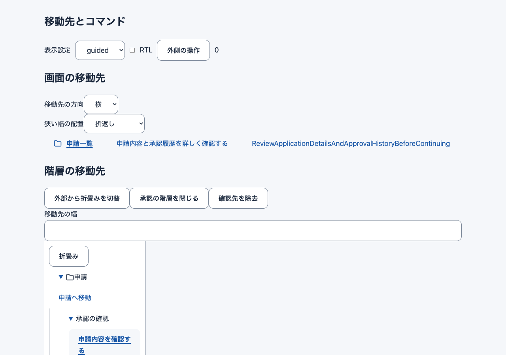 | 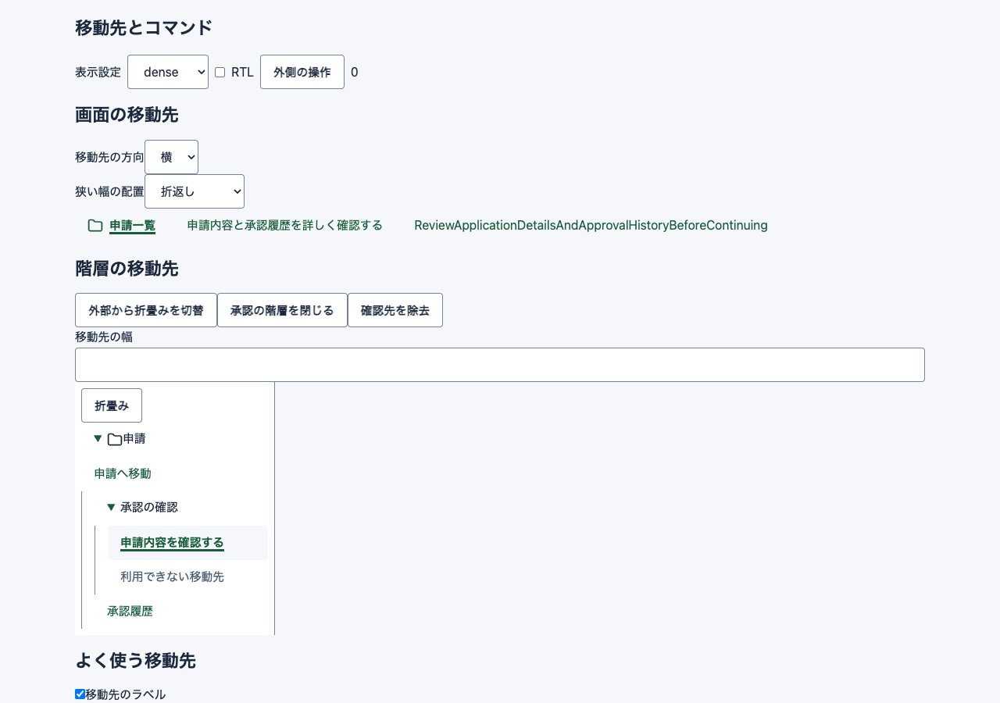 |
| 分類・1280px | 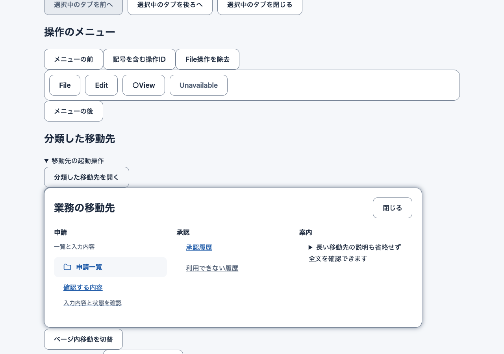 | 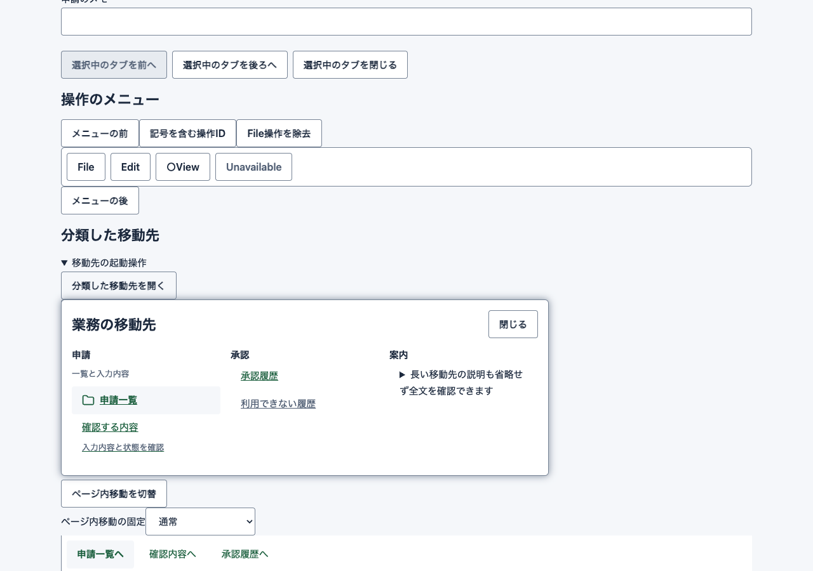 |
| 階層・320/200/RTL | 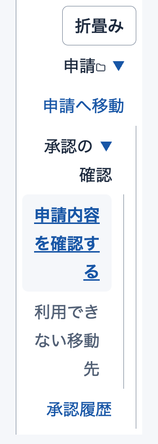 | 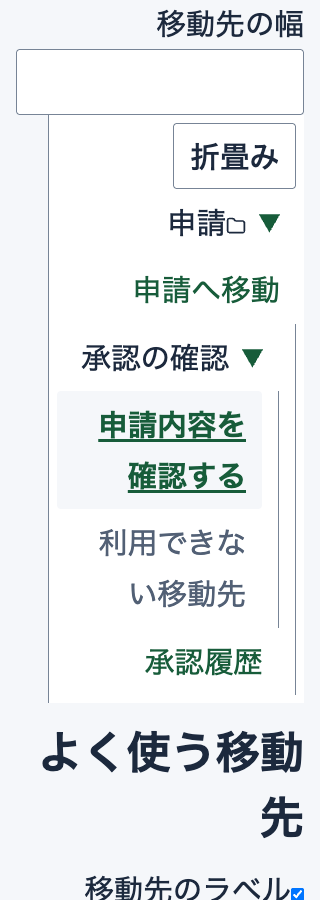 |
| 固定Dock | 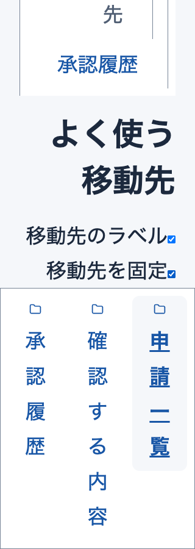 | 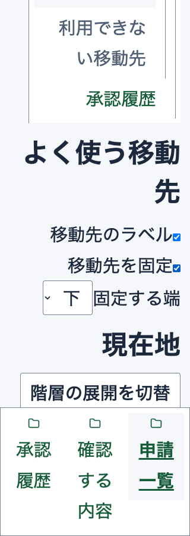 |
| 長い階層 | 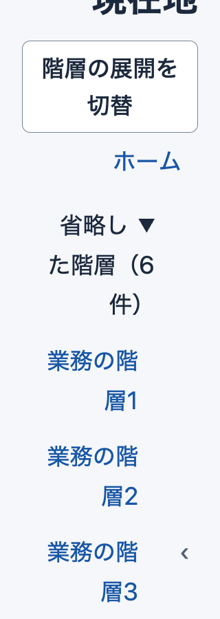 | 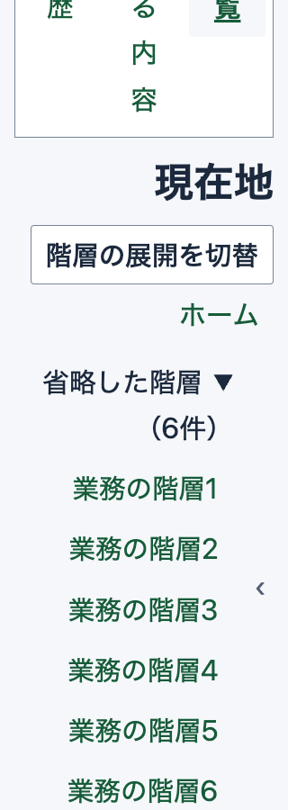 |
| 並べ替え後の入力 | 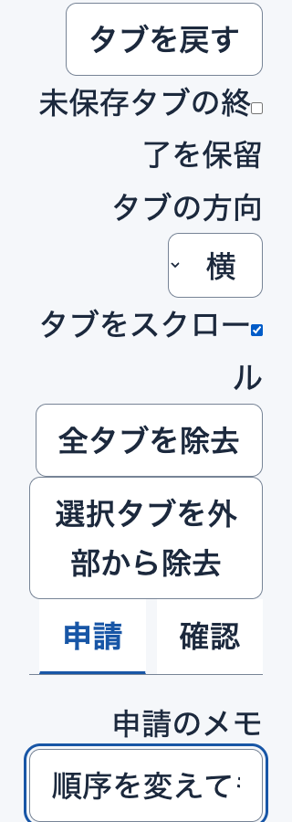 | 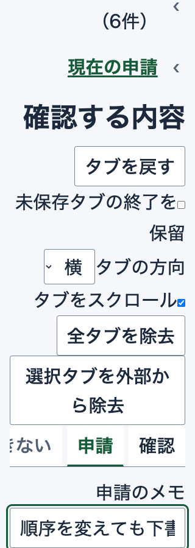 |
| 固定領域と現在見出し |  | 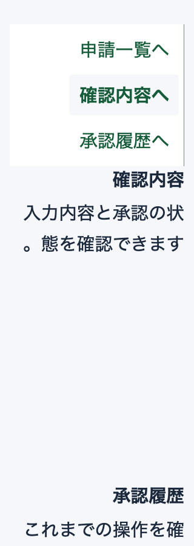 |
| 三階層Menu | 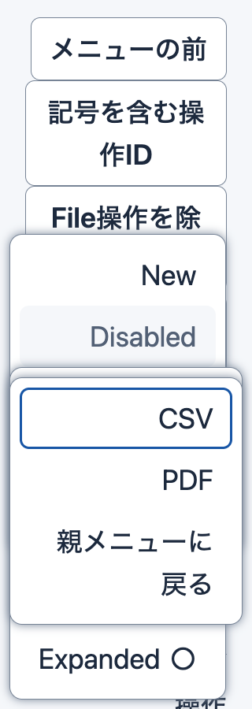 | 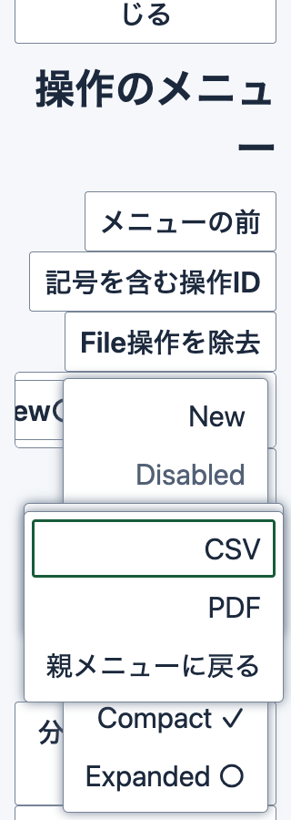 |
| 分類と終了操作 | 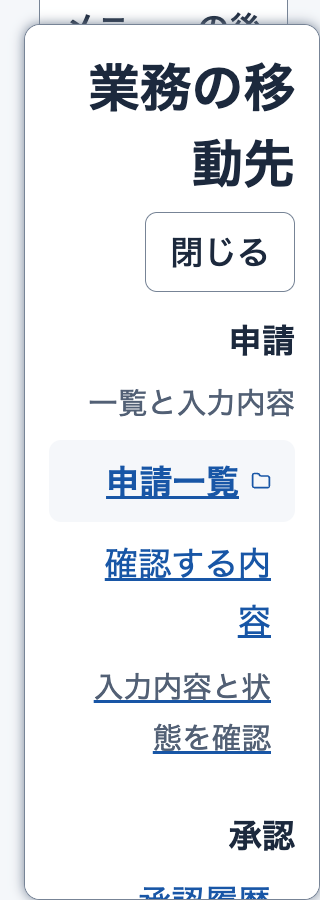 | 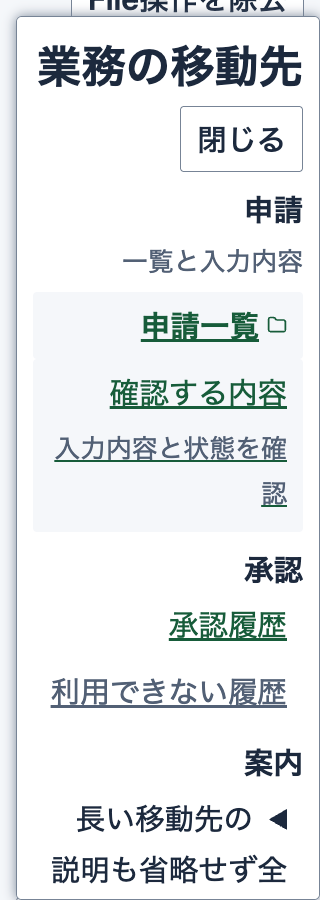 |
| command失敗と再試行 | 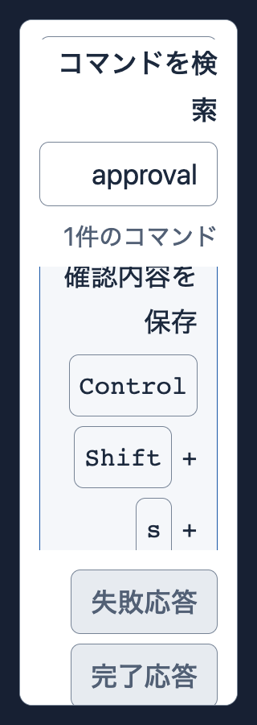 | 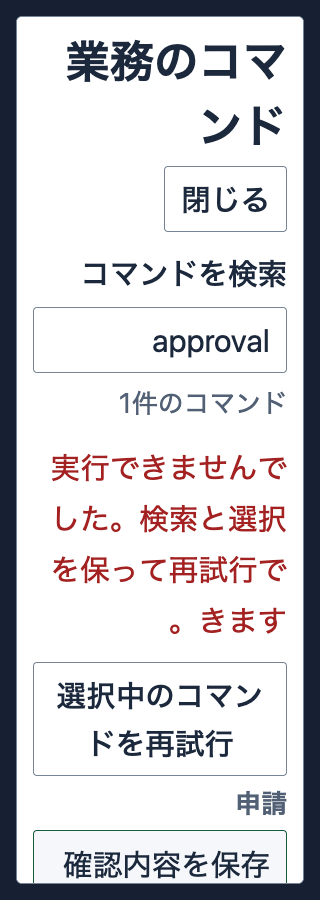 |

拡大した長い内容は内部scrollで全操作へ到達する。三階層popupは狭幅で重なり、現在の子操作と明示的な親復帰を使う。画像1枚にすべての情報が入るという保証はしない。

## 残件

9行の最終更新後は全181要求114 verified/11 partial/56 pending。全依頼は未完了で、入力/予定/一覧・ツリー・表/媒体/専門部品/共通基盤を継続する。既知のoutput移行時Skill所有情報P2は固定出力の同期を妨げない別残件として保持する。

アプリがPaletteを@ifで直接除去する場合のfocusはbodyへ移った。destroy時の所有Observer/RAF/listener解除は独立確認したが、通常closed/completedでの呼出元帰還とは区別し、アプリによる条件除去でのfocus帰還を保証したとは扱わない。

native closeイベント到達前の即時再入は未保証である。独立実キー20回中19回再開、guided1回はEscapeからkまで6.7msでnative dialogが閉じているがcloseイベントが約5ms後のためopened=trueの途中状態だった。閉鎖完了4RAF後は両profileで再開/入力保持を確認した。これは新P1/P2とされていない限界であり、途中phaseを閉鎖完了と同じ契約へ読み替えない。

GitHub workflow/status/review_threadsは0。CI、実screen reader、Firefox/Safari、OS IME/touch、SSR/実Router/通信/永続保存、人の業務評価を成功と表現しない。新依存・有償契約・npm公開・OS設定変更はない。Mac appのPR添付はTransport closedで成功未確認、GitHubのPR/Issue操作と区別する。
